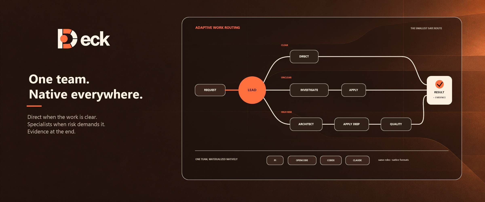
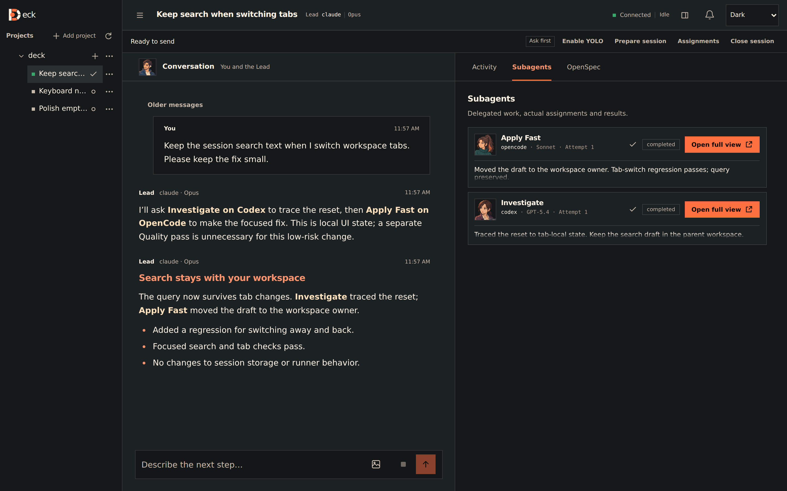
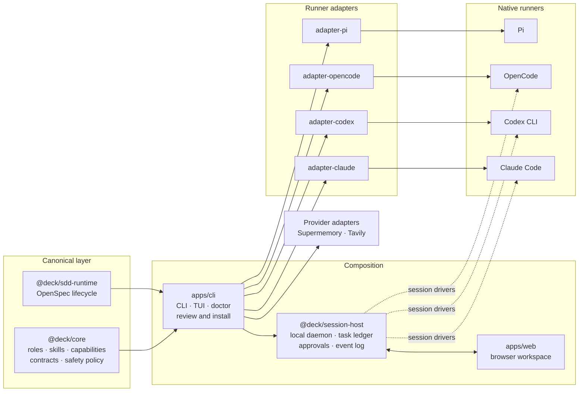
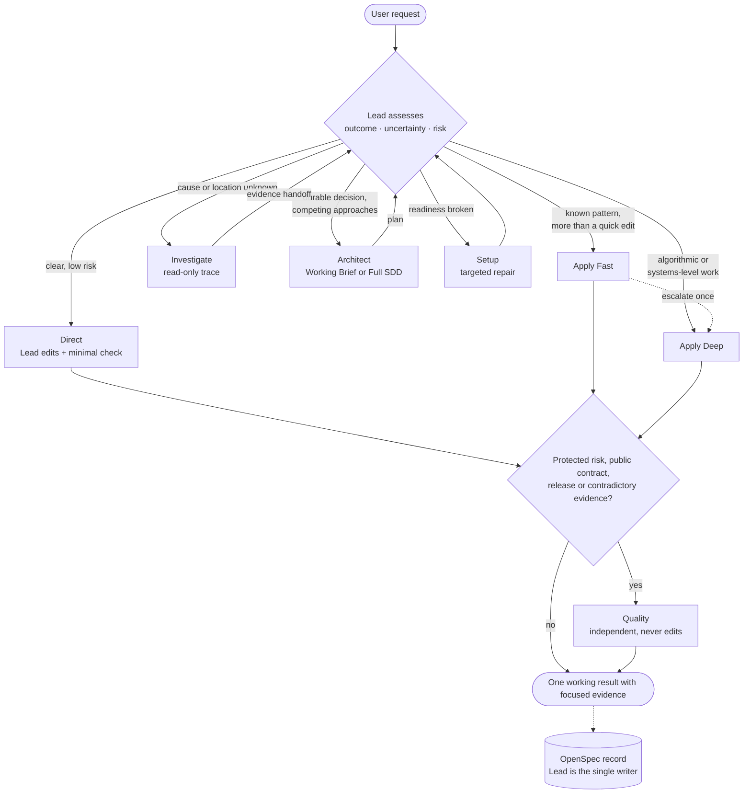

<p align="center">
  
</p>

<p align="center">
  <a href="https://github.com/kevin15011/deck/releases"></a>
  <a href="LICENSE"></a>
</p>

**One adaptive AI developer team, materialized natively in the coding agents you already use.**

Deck defines a Developer Team once (roles, skills, tools, models and safety policy) and installs it natively into Pi, OpenCode, Codex and Claude. Its Lead decides how much process each request deserves, so small fixes stay small and risky changes get investigation, design and independent verification. Deck also runs one team across several runners from a local web workspace, and every step leaves evidence you can inspect.

<p align="center">
  
</p>

## Why Deck exists

Every coding agent has its own format for agents, skills, MCP servers, hooks and model settings. Keeping one way of working across them means rebuilding the same setup by hand, watching it drift, and trusting that it still does what you think. Agent workflows also tend to swing between extremes: no process at all, or a fixed chain of phases that every request must walk through.

Deck treats this as an architecture problem:

- **Define once, materialize natively.** A runner-neutral core describes the team; each adapter translates it into that runner's own files, packages and hooks, then verifies the result.
- **Route by uncertainty and risk.** Process is proportional. The Lead picks the smallest safe route instead of running a ceremony.
- **Evidence over claims.** Preflight, review-before-apply, ownership manifests, `deck doctor` and verified backups make the installation inspectable and reversible.
- **Memory is advisory.** Adaptive memory adds context but never outranks OpenSpec artifacts, source, tests or current runner evidence.
- **No false parity.** Runner differences stay visible in the support matrix rather than hidden behind a generic promise.

## Without Deck vs. with Deck

| Task | Without Deck | With Deck |
|---|---|---|
| Set up a runner for real work | Hand-write agent files, skills, MCP entries, hooks and model settings in that runner's format. | `deck`: preflight shows what is ready; you review the plan, then apply it. |
| Use the same team on another runner | Rebuild everything in a second format and keep both in sync. | Choose another runner; the same canonical team is materialized in its native format. |
| Ask for a one-line fix | The agent either edits blindly or walks a full plan/design/review ritual. | The Lead edits directly and runs the minimum relevant check. |
| Ask for a risky, cross-cutting change | One long agent context mixes discovery, design, code and review. | Investigate traces the code, Architect records decisions in OpenSpec, Apply implements, Quality verifies independently. |
| Combine models from different vendors | Separate terminals and manual copy-paste between agents. | `deck web`: for example, a Claude Lead delegates to Codex and OpenCode members, with tasks, activity and approvals in one browser workspace. |
| Know what is installed and healthy | Inspect scattered config files by hand. | `deck doctor` reports binaries, runner config, MCP checks, memory visibility and suggested fixes. |

## Architecture

Deck separates canonical intent from runner-native effects. The core owns *what* the team is; adapters own *how* each runner receives it; the CLI composes both and keeps the user in control.



- **Native workflows** (`deck` TUI, runner launch commands) install the team into one runner and launch it there.
- **Cross-runner sessions** (`deck web`, `deck cross developer`) run a daemon that assigns a runner and model per team member. Drivers start the unmodified native CLIs under your own login; Deck never copies their credentials.

See [Architecture](docs/architecture.md) for package boundaries and invariants.

## How the Developer Team routes work

The team has seven roles: Lead, Investigate, Architect, Apply Fast, Apply Deep, Quality and Setup. They are not a pipeline. The Lead owns the outcome and activates a specialist only when that role reduces real uncertainty or risk.



Three rules keep it honest:

- **Quality is conditional, not a final phase.** It runs for protected risk, public contracts, releases, contradictory evidence or an explicit request.
- **One implementation owner per slice.** Follow-up feedback (rename it, move it, try another option) stays with the same owner instead of restarting the process.
- **OpenSpec is the official record.** Specialists return compact results; the Lead writes the delta, Working Brief or Full SDD that the change actually needs.

Details: [Developer Team](docs/developer-team.md).

## What works today

| Surface | Status | Scope |
|---|---|---|
| Pi | **Supported** | Detection, package review, global team install, per-role subagents and models, `deck pi developer`. Requires Pi 1.0.0 or newer. |
| OpenCode | **Supported** | Detection, package and config review, native agents, team install through the TUI. |
| Claude | **Full team, instruction-level safety** | Global Deck-owned plugin: all seven roles, subagents, per-role models, pinned shared tools, the official Supermemory plugin and supervised launches through the Deck CLI. Protected execution controls are guided by instructions rather than enforced by a runner hook. Full driver in cross-runner sessions. |
| Codex | **Full team, instruction-level safety** | Native Codex roles and skills installed globally, per-role models, shared tools and hooks, the official Supermemory plugin, and interactive, exec and resume launches. Protected execution controls are guided by instructions rather than enforced by a runner hook. Full driver in cross-runner sessions. |
| Cross-runner sessions and web workspace | **Experimental** | Local daemon and browser workspace with Claude, Codex and OpenCode drivers; Pi stays on its native workflow. |
| Adaptive memory | **Optional** | Off by default; Supermemory integration differs per runner and never overrides official artifacts. |
| Bundled skills | **Supported** | 29 standalone skills shipped as content and cataloged by goal. |

Known gaps are listed explicitly in the [support matrix](docs/reference/support-matrix.md), the single source of truth for runner status.

## Quickstart

Published binaries target **macOS and Linux** on **x64 and arm64**:

```sh
curl -fsSL https://raw.githubusercontent.com/kevin15011/deck/main/scripts/install.sh | bash
```

The installer verifies release checksums by default. Then open the interactive deck, choose a runner, review the plan and apply it:

```sh
deck
deck version
deck doctor
```

To run a team across runners from the browser:

```sh
deck web
```

If an older binary is blocked before it can update itself, download the installer over HTTPS to a temporary path and run `bash "$installer_path" --recovery --dir "$HOME/.local/bin"`. Recovery needs an explicit writable `--dir` and does not use `--insecure` or privilege escalation. See [Getting started](docs/getting-started.md) for source checkouts, recovery and first runs.

<details>
<summary><strong>Codex CLI notes</strong></summary>

Codex CLI `0.145.0` or newer is a registered Developer Team environment:

```sh
deck codex developer --dry-run
deck codex developer --yes
deck codex developer resume --last
```

Deck previews changes before applying them globally: marker blocks in `$CODEX_HOME/config.toml`, native Codex roles and skills (roles under `$CODEX_HOME/agents/deck-*.toml`, skills under `~/.agents/skills/`), and Deck's manifest and hook scripts in `$CODEX_HOME/deck/`. Nothing is written into your projects, and Deck never enables repository trust.

> **Warning:** Every non-install-only Codex Developer Team launch passes `--dangerously-bypass-approvals-and-sandbox`. Sandboxing and command approvals are disabled for that Codex process, so it may modify or delete files and run commands without approval. Deck does not persist this bypass in project or global Codex configuration.

See [runner support](docs/runner-support.md) for MCP, memory, ownership, rollback and known gaps.

</details>

## Choose your next move

| If you want to… | Read |
|---|---|
| Install Deck and configure your first runner | [Getting started](docs/getting-started.md) |
| Understand runner boundaries and status | [Runners](docs/runners.md) and [support matrix](docs/reference/support-matrix.md) |
| Run one team across Claude, Codex and OpenCode | [Cross-runner sessions](docs/cross-runner-sessions.md) |
| Configure packages, MCP, models or reasoning | [Configuration](docs/configuration.md) |
| Understand the seven roles and adaptive routing | [Developer Team](docs/developer-team.md) |
| Browse lifecycle and bundled skills | [Skills](docs/skills.md) |
| Decide whether memory belongs in your workflow | [Adaptive memory](docs/adaptive-memory.md) |
| Run updates, rollback or diagnostics | [Operations](docs/operations.md) |
| Validate OpenSpec or discover project-local skills | [Project workflows](docs/project-workflows.md) |
| Look up exact command forms | [CLI reference](docs/reference/cli.md) |
| Recover from a blocked setup | [Troubleshooting](docs/troubleshooting.md) |
| Contribute | [Contributing](CONTRIBUTING.md) and [Architecture](docs/architecture.md) |
| Read how Deck was designed and built | [Building Deck](docs/building-deck.md) |

## License

Deck is released under the [MIT License](LICENSE) and maintained by Kevin Londoño at <https://github.com/kevin15011/deck>. The story behind it is in [Building Deck](docs/building-deck.md).

> **Audience:** People evaluating, installing, or operating Deck.
> **Authority:** Product orientation; executable source and tests define current behavior.
> **Maintainer:** Deck maintainers.
> **Evidence:** [CLI parser](apps/cli/src/cli-args.ts), [CLI composition](apps/cli/src/main.tsx), [installer](scripts/install.sh), [runner capability registry](packages/core/src/runner-capability-registry.ts), and [documentation governance](tests/documentation-governance.test.ts).

Maintainer procedures: [release guidance](docs/maintainers/releasing.md), [release descriptors](docs/release-descriptor.md) and the [OpenSpec configuration](openspec/config.yaml).
