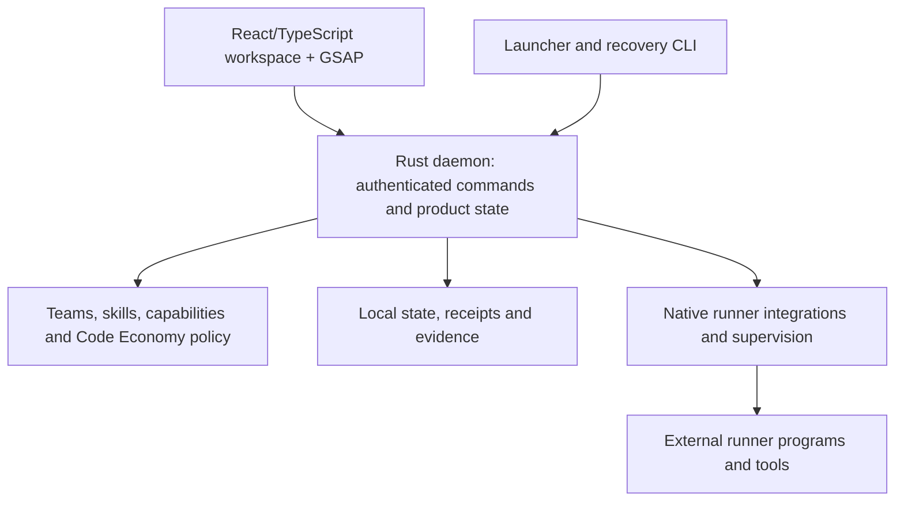

# Rust product direction

Status: the user approved **Rust backend/launcher + React/TypeScript/GSAP browser** after rejecting the initial UI. The packaged replacement is validated and installed for the bounded Sprint 1 scope after independent review and Lead execution of the requested follow-up. The Rust/Leptos build remains historical evidence; the [verification record](sprints/sprint-01-verification.md) identifies actual versions, checks and limits.

## Browser application

Use **React + TypeScript with GSAP**, backed by the independent Rust daemon. Reuse appropriate current Deck presentation components, CSS/theme/font/brand assets and interactions; adapt their data inputs to the new host contracts instead of importing the old session host or runtime. Keep the new source/build independent of the sibling repository, which remains a reference.

Build a static browser bundle and embed it in `deck2`. JavaScript tooling is a development/build dependency; the packaged application must not require Node/Bun, a web development server or a CDN at runtime. Choose one small build path, pin dependencies and record its actual validation commands. Do not introduce SSR or a second application server without a product need.

The Rust host remains authoritative for authentication, admission, permissions, execution, persistence and recovery. The browser owns presentation/drafts. Keep a small typed API boundary with runtime checks for compatibility and malformed data; TypeScript types alone do not validate host responses. Preserve the existing command identity and uncertain-outcome guarantees.

Retire the Leptos application from the active build only after preserving its evidence and moving its applicable behavior/security oracles to the replacement. Do not ship two parallel UIs. The earlier Cargo/wasm-bindgen candidate remains historical evidence; no React runtime or performance claim transfers automatically from it.

Primary documentation consulted for the approved direction: [React with an existing backend](https://react.dev/learn/add-react-to-an-existing-project), [GSAP and React](https://gsap.com/resources/React/). Reuse and lower reimplementation risk are project-specific judgments, not a framework benchmark.

## Small initial architecture

Start with three build boundaries: browser application, native application and shared serializable contracts. Within the native application, use ordinary modules for product logic, runner integrations, persistence and operation jobs until concrete requirements justify extraction. Code Economy applies: no speculative plugin framework, microservices or crate per conceptual box.

The daemon owns authority and survives browser-window closure. Browser state owns drafts and presentation, not permissions. Shared contracts describe commands, events, availability, errors and receipts without exposing secrets or privileged implementation types.

Sprint 1 uses SQLite for state/receipts. Managed attachment storage remains later work. This does not adopt the old Deck ledger format or freeze the complete future database design. Keep one authoritative writer for each live execution/state domain.

The first external dispatch needs authenticated local access, origin/host validation, project scope, command/attempt identity, durable intent, cancellation and stale-authority checks, bounded events, reconnect and honest uncertain outcomes. Approval semantics must precede write-capable actions. Idempotent command handling does not imply exactly-once native execution.

The [proposed operating model](operating-model.md) applies these boundaries to canonical instructions, shared Deck-owned tools, per-attempt exposure, diagnostics and manual/optional automatic updates. It prefers verified process-scoped integration, distinguishes selected from in-use versions, and uses explicit maintenance for stateful services when safe parallel operation is unproven. These remain modules and contracts within the same small architecture.

## Browser integration boundaries

- Streaming uses authoritative event identities and reconnect cursors; reactive rendering is not the durable event store.
- Attachments use host-side validation and managed storage; a filename is not permission to access a host path.
- Voice has feature/permission detection and a usable text fallback.
- Push/PWA support is browser/deployment dependent and separate from executing work offline.
- GSAP implements movement, appearance/disappearance, expansion/collapse, panel and tab/selection transitions. Keep feedback immediate, easing restrained, transitions interruptible, and owned tweens/listeners cleaned up. Reduced motion must not delay access or focus. Do not animate the same property simultaneously with CSS and GSAP.
- Semantic controls, keyboard focus, mobile layout and visual comparison are acceptance work, not framework guarantees.

## Coexistence and portability

Keep the provisional `deck2` command and separate development URL/port while Deck1 remains in use. The source workspace remains `deck-next`. The user's compatibility requirement (prompt859b73f0-a31b-42c8-a7b6-8741b7ad2f55) supersedes the earlier blanket separate-data namespaces and optional-snapshot-import-only strategy. Deck2 must preserve/use existing projects, sessions/history, preferences, downloaded models and configuration. Deck1 is the authoritative source; the user does not require preservation of experimental Deck2 history/settings and permits shared paths/writes. No two-way merge/synchronization is required merely to preserve Deck2 state. Sharing requires compatible formats and coordinated writer ownership; neither a directory rename nor two independent writers establishes compatibility. Use disposable projects or separate worktrees for concurrent development effects.

Preserve native-runner-owned credentials and the original authentication/permission contract. History must not create execution authority or adopt another host's active processes. Trace device/pairing credentials and notification identity as compatibility data rather than discarding them by default. During eventual replacement preserve the original web origin, PWA identity, Tailscale route and notification configuration through a verified compatible transition. Current ports remain unchanged. A read-only bridge or consistent snapshot may support an incremental implementation, but an optional manual import alone does not satisfy the requested shared-data outcome. The controlling compatibility brief is [fidelity-correction.md](../openspec/changes/deck-recreation/fidelity-correction.md).

Before the first runner materialization or configuration effect, decide ownership of native profiles, agents, skills, hooks, MCP/configuration blocks and ownership manifests. Either verify isolated locations for the exact runner/version, or explicitly review shared resources, detect collisions and protect both installations' active work. Separate Deck state directories and credential reuse do not establish this boundary. S4 must satisfy this gate before materialization; S5 must preserve it for configuration changes. If an earlier sprint needs such an effect, the gate moves earlier with it.

Early rollback can mean returning to an untouched old product only when the native-resource boundary above has been demonstrated. With reviewed shared resources, recovery must also account for their changes and current ownership; restoring an old snapshot must not overwrite concurrent user changes. Later rollback within the new product requires compatible retained state; restoring only the executable is insufficient after an incompatible migration. Retiring or deleting old Deck remains a separate product/user decision.

## Evidence

Architect task `task-8d131b71-89c0-402b-aac3-a8d9521e3134`, attempt 2, events 21831/21832 supplied the earlier Rust-browser recommendation. The user's subsequent approval of React/TypeScript/GSAP supersedes that frontend choice. The product contracts and Rust host direction remain. The latest [implementation brief](../openspec/changes/sprint-01-deck2/working-brief.md) records scope and ownership; runtime compatibility and performance require evidence from the replacement candidate.
