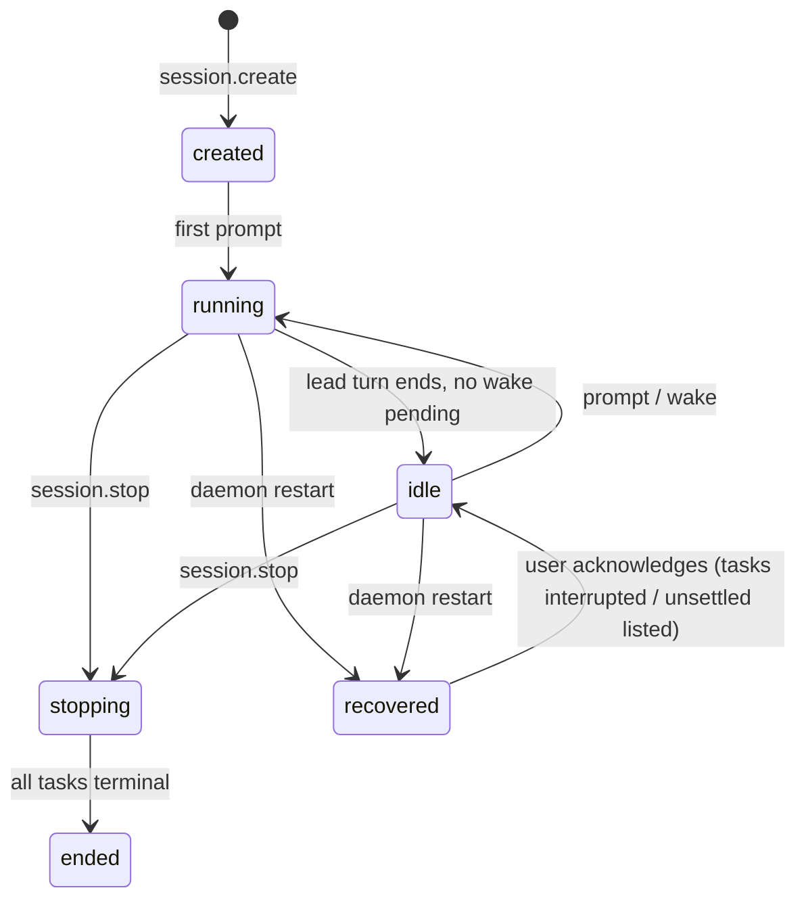
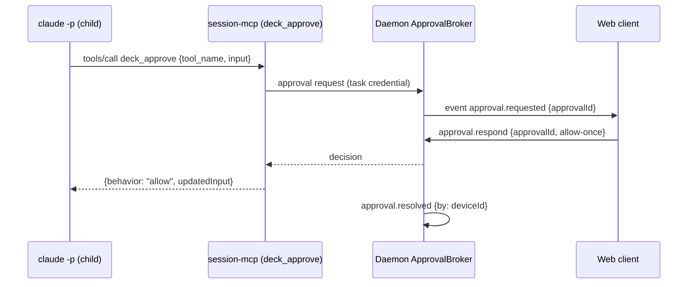

# Design: Cross-Runner Session Core

> Normative behavior is in [spec.md](spec.md); delivery order is in [tasks.md](tasks.md). This document records **decisions, rejected alternatives, and rationale**. Evidence comes from [working-brief.md](working-brief.md) and the current source (verified 2026-10-12 on branch `fix/claude-model-config-blocked-plan`).

## 1. Summary

```
 desktop browser ─────────────────► 127.0.0.1:<web port> ─┐   (loopback only; any wider exposure is the user's own proxy)
 deck cross / deck session (CLI) ───► daemon.sock (0700/0600) ─┤
 TUI (config only) ──► config.json                             ▼
                                         ┌──────────── deck session daemon ───────────┐
                                         │ SessionManager · EventLog · Ledger          │
                                         │ ApprovalBroker · MemoryBroker · Supervisor  │
                                         └──┬──────────────┬──────────────┬────────────┘
                              anchor+pgid   │              │              │
                                     claude -p        codex app-server   opencode serve
                                     (lead?)          (member?)          (member?)
                                         └── each child runs `deck internal session-mcp`
                                             (stdio MCP → daemon.sock, task-scoped credential)
```

One daemon per user hosts many sessions. Each session owns a Lead task and delegated tasks; each task runs in its assigned runner through that adapter's driver. Children reach Deck only through the session MCP bridge.

## 2. Package boundaries

| Unit | Owns | Must not |
|---|---|---|
| `@deck/core` `src/session/` | Event/command types and validators, `RunnerQualifiedAssignment`, `RunnerSessionDriver` interface, redaction rules, child MCP set computation (pure). | Node process/net/fs. |
| **new** `@deck/session-host` (`packages/session-host`) | Daemon core: SessionManager, EventLog, Ledger projection, Supervisor (anchor), ApprovalBroker, MemoryBroker port, HTTP/WS + Unix-socket servers, session MCP bridge server logic. | Import adapters, TUI, CLI argv parsing. |
| `packages/adapter-claude`, `adapter-codex`, `adapter-opencode` | `getSessionDriver()` implementations + recorded fixtures. | Spawn outside the host's supervised spawn; touch credentials. |
| `apps/cli` | Composition: registers drivers, embeds web assets, `deck session`/`deck cross` commands, `deck internal session-daemon|session-mcp|child-anchor`, Doctor, TUI cross flow. | Duplicate host logic. |
| **new** `apps/web` | Desktop web client source (React, already in stack), built by `Bun.build` into a generated, embedded module. | Load third-party origins at runtime. |
| `packages/adapter-pi` | Untouched (uncommitted Pi work is out of bounds). | — |

**D-1 New `@deck/session-host` package.** Rejected: putting the daemon in `@deck/core` (breaks core purity, already repaired once); in `@deck/sdd-runtime` (owns OpenSpec lifecycle, not processes); in `apps/cli` (untestable without CLI composition and tangles with Ink).

## 3. Contracts (S0)

### 3.1 Event envelope — `deck-session-event-v1`

```ts
type SessionEvent = {
  v: 1; sessionId: string; seq: number; ts: string;           // ISO 8601
  kind: SessionEventKind;
  source: { memberId?: string; taskId?: string; runnerId?: RunnerId; nativeSessionId?: string };
  data: Record<string, unknown>;                               // kind-specific, validated
  raw?: { runnerId: RunnerId; protocol: DriverProtocol; payload: unknown; truncated: boolean };
};
```

| Kind group | Kinds |
|---|---|
| Session | `session.created`, `session.bound`, `session.state`, `session.ended`, `session.recovered` |
| Task | `task.created`, `task.state`, `task.continued`, `task.result` |
| Turn | `turn.started`, `turn.completed {status: completed\|interrupted\|interrupted-forced\|failed}` |
| Content | `message.delta`, `message.completed`, `reasoning.delta`, `tool.started`, `tool.completed` |
| Control | `approval.requested`, `approval.resolved`, `memory.recalled`, `memory.proposed`, `memory.written` |
| Ops | `usage`, `rate-limit`, `diagnostic`, `runner.unmapped`, `client.attached`, `client.detached` |

**D-2 Normalize with a raw escape hatch.** Normalized kinds give clients one renderer; `raw` (redacted, ≤64 KiB) preserves detail the mapping drops and makes drift debuggable. Rejected: pass-through native events (three renderers, no cross-runner UI); fully lossless normalization (unbounded schema churn tracking three protocols).

**D-3 Deltas are persisted but compactable.** `message.delta` events are persisted (cursor resume must be gap-free) and, on segment rotation, closed turns may be compacted into their `message.completed`; compaction never renumbers `seq`, and a resume cursor inside a compacted range receives the `message.completed` instead. Rejected: not persisting deltas (mid-turn reconnect would lose text).

### 3.2 Commands — `deck-session-command-v1`

`session.create {projectRoot, changeId?}`, `session.attach {after}`, `session.bindChange {changeId}`, `prompt.send {text, target?: "lead"}`, `turn.interrupt {taskId}`, `approval.respond {approvalId, decision}`, `task.cancel {taskId}`, `session.stop`. All carry `commandId` (UUID) for idempotency (XR-1.5).

### 3.3 Cursor resume

`seq` is the cursor. Attach = "send backlog `seq > after` from the log, then switch to live"; the server holds a per-client bounded queue (default 2 000 events). On overflow it closes with code `resync` and the client reattaches with its last cursor. Rejected: per-client server-side offsets (stateful, breaks with multiple devices); timestamps (not unique).

### 3.4 Runner-qualified assignments

```ts
type RunnerQualifiedAssignment = { runnerId: RunnerId; modelId: string; thinking?: string };
type CrossTeamAssignments = Record<string /* memberId */, RunnerQualifiedAssignment>;
// helpers (pure): qualifyAssignments(runnerId, flat, thinking), projectForRunner(runnerId, cross)
```

**D-4 Add a qualified type next to the flat one; do not mutate the flat type.** Every adapter reads/writes native assignments through `DeveloperTeamModelAssignments` (`readModelAssignments`); changing it would ripple through four adapters and their native files for no user value. Cross assignments live in Deck config only. Rejected: replacing the flat type in place (large blast radius, conflicts with uncommitted Pi work).

**D-5 Config location and migration.** `crossRunner` is an optional key in the existing global `config.json` (single preferences source per [docs/architecture.md](../../../docs/architecture.md)); `DECK_CONFIG_VERSION` stays `1` because the change is additive. Legacy string member values normalize to the qualified shape with a warning (XR-2.2). Verified in S0 (task 0.8): pre-change binaries do NOT drop the unknown key; they reject it with `DECK_CONFIG_UNKNOWN_FIELD`, so a downgrade requires removing `crossRunner` from `config.json` first (documented in the proposal's rollback section). Rejected: separate `cross-runner.json` (violates the one-source invariant); version bump to 2 (forces a migration for unaffected users).

```jsonc
"crossRunner": {
  "enabled": true,
  "members": { "lead": { "runnerId": "claude", "modelId": "opus", "thinking": "high" },
               "apply-deep": { "runnerId": "codex", "modelId": "gpt-5.6-sol", "thinking": "high" } },
  "approvals": { "claude": "runner-default", "opencode": "runner-default", "codex": "runner-default" },
  "maxConcurrentTasks": 4,
  "web": { "port": 7421, "trustedProxy": null, "allowedOrigins": [], "allowFunnel": false },
  "claudeTosAcknowledgedAt": null
}
```

Members without an entry are not delegable in cross sessions (the Lead is required).

## 4. Driver interface (RunnerAdapter extension)

```ts
interface RunnerAdapter { /* existing… */ getSessionDriver?(): RunnerSessionDriver }

interface RunnerSessionDriver {
  readonly runnerId: RunnerId;
  readonly protocol: "claude-stream-json" | "codex-app-server" | "opencode-serve";
  readonly testedVersions: { min: string; maxTested: string };
  probe(ctx: DriverProbeContext): Promise<DriverProbe>;            // version, isolation check, capabilities; never reads credentials
  startTask(input: DriverTaskInput, io: DriverHostIo): Promise<DriverTaskHandle>;
}
type DriverTaskInput = {
  taskId: string; memberId: string; cwd: string; assignment: RunnerQualifiedAssignment;
  rolePrompt: string; prompt: string; resume?: { nativeSessionId: string };
  mcp: ChildMcpSet; approvals: "relay" | "runner-default"; credentialFile: string;
  disableNativeDelegation: boolean;
};
type DriverHostIo = { spawn: SupervisedSpawn; emit(e: DriverEvent): void; approval(req): Promise<Decision> };
type DriverTaskHandle = {
  nativeSessionId: Promise<string>; send(prompt: string): Promise<void>;
  interrupt(): Promise<void>; done: Promise<TurnOutcome>; close(): Promise<void>;
};
```

**D-6 Optional method on `RunnerAdapter`, not a parallel registry.** Keeps one composition root (`apps/cli/src/runner-adapters.ts`) and lets a runner without a driver (Pi) be excluded by capability. Rejected: separate driver registry (two sources of runner truth); making it required (forces stubs into Pi).

**D-7 Drivers never spawn.** `SupervisedSpawn` from the host wraps every child in the anchor (section 6). One containment implementation, testable once.

**D-8 One native process per task (per turn for Claude).** The MCP bridge must know *which* task is calling; MCP config (with the task credential file) is per process for all three runners. Rejected: one shared app-server/serve per session (cannot attribute MCP calls to a thread; one crash takes all tasks). Cost: process start latency per task — acceptable for delegation granularity.

### 4.1 Per-runner backend specifics

| Concern | Claude (stream-json) | Codex (app-server JSON-RPC) | OpenCode (serve HTTP+SSE) |
|---|---|---|---|
| Start | `claude -p --model M --session-id <uuid> --input-format stream-json --output-format stream-json --verbose --append-system-prompt <role>` per turn; later turns `--resume <uuid>` | `codex app-server` stdio: `initialize` → `initialized` → `thread/start` or `thread/resume` → `turn/start {model, effort}` | `opencode serve --pure --port 0 --hostname 127.0.0.1`; `POST /session` or reuse id; `POST /session/:id/message {model:{providerID, modelID}}` |
| Native id | Deck-assigned UUID (persisted **before** spawn) | `thread.id` from `thread/start` result | session id from `POST /session` |
| Events | stdout JSONL: `system/init`, `assistant`, `user` (tool results), `result` | notifications: `turn/*`, `item/*`, `thread/tokenUsage/updated`, `account/rateLimits/updated` | SSE `/event`: `session.status`, `message.part.delta`, `session.idle`, `permission.*` |
| MCP isolation | `--strict-mcp-config --mcp-config <0600 file>` (proven) | metadata-only effective-config inventory, supervised restart with inherited servers/plugins disabled and explicit `-c` child specs, fail-closed effective-config and actual MCP-set verification before prompt (see S2 correction below) | Deck-owned config dir via env + `OPENCODE_CONFIG_CONTENT`; **`--pure` alone leaked user MCPs** (spike) |
| Hook isolation | settings override disabling hooks (`--settings` file), never `--bare`; verify `--safe-mode` + explicit MCP compatibility | `features.hooks=false` covers native hooks.json and inline hooks; verify effective feature values before thread startup | Deck-owned config dir excludes user plugins |
| Approvals | `--permission-prompt-tool mcp__deck__deck_approve` → `{behavior, updatedInput}` (proven allow path) | server request `item/commandExecution/requestApproval` (+ fileChange) → `{decision}` (accept proven; decline to verify) | `ask` permission → `POST /permission/{id}/reply {reply: once\|always\|reject}` (proven once) |
| Interrupt | `SIGINT` to CLI pid → `result error_during_execution`, exit 0 (proven) | `turn/interrupt {threadId, turnId}` → `turn/completed status interrupted` (proven) | `POST /session/{id}/abort` → idle (proven) |
| Native delegation off | `--disallowedTools Task` (verify name) | disable multi-agent feature via `-c` (verify) | permission `task: deny` |
| Pitfalls | Without relay/allowedTools headless denies (`permission_denials`) | stdin must be a pipe we own (exec blocked on stdin when inherited); experimental protocol | Long-lived server per task; random port; set server password if supported (verify) |

**D-9 OpenCode isolation via a Deck-owned config directory.** The spike shows `--pure` + config content still loaded user MCPs, so Deck points OpenCode's config home at a per-task Deck-owned directory while leaving its data home (where auth lives) untouched, and verifies isolation via the probe's tool list. Rejected: deny-listing every user MCP id (fragile, races user edits); copying auth (violates the credential non-goal).

**S2 correction (2026-10-12): Codex app-server isolation.** The installed Codex 0.162.1 exposes `--ignore-user-config` only on `exec`, not on `app-server`. Both root and app-server placements reject it. A synthetic-home app-server `config/read` probe independently showed that `mcp_servers={}` and `plugins={}` merge rather than replace inherited tables. Keep app-server and native authentication storage; inspect effective configuration only in memory, disable inherited MCP/plugin entries, explicitly materialize the child set, disable hooks/native delegation/apps, and verify the enabled configuration and actual MCP set before delivering a prompt. Unexpected or unrepresentable inherited entries must fail closed. No runner credentials are read/copied and no config RPC write is allowed. This corrects an assumed mechanism, not XR-4.3's isolation requirement; S2 live evidence must establish readiness before closure. Official references retrieved 2026-10-12: [configuration flags](https://learn.chatgpt.com/docs/config-file/config-reference), [effective config and MCP status RPCs](https://learn.chatgpt.com/docs/app-server).

## 5. Delegation and the proxied Lead (S3)

Concurrency clarification (2026-10-12): `maxConcurrentTasks` counts delegated jobs, matching task 3.2's explicit six delegations → four running/two queued acceptance. The Lead has a separate coordinator slot so its waiting turn cannot consume the only worker slot when the configured limit is one. The default can therefore run four delegated native turns plus the Lead. This is a scheduling limit, not a claim of four total operating-system processes.

**D-10 Delegation as a Deck MCP server, async with daemon wake.** All three runners already accept a Deck stdio MCP server (spike round 2), and Deck already ships `deck internal memory-mcp`/`serena-mcp` the same way. `deck_delegate` returns a `taskId` immediately because runner MCP tool-call timeouts (e.g. Codex default tool timeout) make long-blocking calls unsafe; `deck_task_wait` is bounded to ≤50 s; when the Lead goes idle with pending tasks, the daemon wakes it with a completion notice (the Pi `notify` pattern). Rejected: blocking `deck_delegate` until completion (timeouts, no concurrency); runner-native subagents (cannot cross runners); Pi as host (user decision).

**D-11 Bridge transport.** `deck internal session-mcp` speaks MCP stdio to the child and JSON frames to `daemon.sock`, authenticated by a task-scoped credential read from a `0600` file named in env (`DECK_SESSION_CREDENTIAL_FILE`). The credential encodes `{sessionId, taskId, memberId, allowedTools}` server-side and is revoked when the task ends. Rejected: token in argv/inline MCP JSON (visible in `ps`); TCP loopback for children (would share the web port).

**D-10 follow-up (2026-10-13): completion delivery suppresses redundant wake.** A terminal result returned through the Lead's `deck_task_wait` or `deck_task_result` acknowledges that task attempt's completion notice. The acknowledgement must also suppress a notice enqueued later in the same synchronous completion path; removing only an already-present queue entry is insufficient because event subscribers can observe terminal state before notice creation. Partial timeout responses acknowledge their terminal entries only, while aborted calls and observer reads acknowledge none. A later attempt and unseen tasks retain their notifications. This is daemon tool-response acknowledgement, not a claim of transport-level exactly-once delivery. The existing bounded automatic wake remains necessary when the Lead has not obtained the result.

```mermaid
sequenceDiagram
  participant U as Client (web/CLI)
  participant D as Daemon
  participant L as Lead (claude -p)
  participant B as session-mcp bridge (in Lead)
  participant C as Codex app-server (architect)
  U->>D: prompt.send(commandId)
  D->>L: spawn turn (--resume lead uuid)
  L->>B: tools/call deck_delegate {agent: architect, task}
  B->>D: delegate (task credential)
  D->>D: ledger task.created T1 {codex, model, thinking}
  D-->>B: {taskId: T1}
  B-->>L: {taskId: T1}
  D->>C: spawn anchor → app-server; thread/start; turn/start
  C-->>D: item/* notifications → normalized events (seq++)
  L-->>D: result (turn completed, Lead idle)
  C-->>D: turn/completed
  D->>D: task.state T1 completed, nativeSessionId = thread N
  D->>L: wake turn: "T1 completed" (bounded notice)
  L->>B: deck_task_result {T1}
  Note over L,C: Later: deck_delegate {architect, continueTaskId: T1} → thread/resume N
```

**D-12 Owner contract.** The ledger maps `taskId → [{attempt, runnerId, modelId, thinking, nativeSessionId, state}]`. Continuation uses the **recorded** runner/model because native context is not portable; assignment changes affect new tasks only. If native resume fails (expired/missing), reseed a fresh native session with a bounded Deck summary from the event log and mark `continuity: reseeded`. Rejected: following the current assignment on continuation (silently loses context); refusing on resume failure (dead end for the user).

**D-13 Only the Lead delegates.** Matches the existing team model (Lead coordinates; specialists do not re-delegate) and bounds fan-out. Depth > 1 is a later decision.

## 6. Supervision, persistence, lifecycle

### 6.1 Process containment (ported lessons from the Pi supervisor/lease)

`deck internal child-anchor` is spawned `detached` (own process group) with an IPC channel. It spawns the native CLI inside its group and:
- on IPC `disconnect` (daemon died) → `kill(-pgid, SIGKILL)`;
- reports `exit` only after stdout/stderr reach EOF or a 1 s drain timeout (never promote partial output to success);
- never exits before the daemon acknowledges terminal cleanup (prevents PID reuse races).

Recovery **never signals a PID read from disk**. A changed boot session (`boot_id` / `kern.bootsessionuuid`) settles ownership outright: a reboot proves the recorded processes are dead, and PIDs are not consulted because they may have been reused. Within the same boot, Linux verifies `(pid, starttime)` and Darwin accepts only proven absence (`kill(pid, 0)` → `ESRCH`); anything else (alive, reused, unreadable lease, unknown boot) is `ownership-unsettled` (XR-3.7). Interrupt sends `SIGINT` to the CLI pid only (Claude needs a clean `result`), escalation targets the group.

**D-14 Children die with the daemon; continuity comes from native resume.** Stdio-piped children cannot be re-adopted by a new daemon. Rejected: surviving children with re-attach (requires named pipes/PTYs per runner, high complexity, orphan risk).

### 6.2 Storage layout (user state dir, never the repo)

```
$XDG_STATE_HOME/deck/                    (default ~/.local/state/deck)
  daemon/  daemon.lock  daemon.sock*  daemon.json (pid, nonce, version, ports)
  sessions/<sessionId>/
    session.json        project root, changeId, state, created, members snapshot
    events/000001.jsonl append-only, rotate at 16 MiB
    ledger.snapshot.json  projection checkpoint {seq, tasks}
    tasks/<taskId>/     credential (0600, deleted at terminal), mcp-config files, scratch
  web/ devices.json (hashed tokens), pairing (ephemeral)
  logs/daemon-YYYYMMDD.jsonl (rotated, redacted)
```
\* If the socket path exceeds the platform `sun_path` limit (104 bytes on Darwin), use `$TMPDIR/deck-<uid>/daemon.sock` after verifying owner and `0700`.

Writes: append + `fsync` per batch (≤50 ms window); snapshot via atomic rename. Retention default: 30 days or 50 sessions, whichever is smaller; `deck session prune`.

**D-15 Event sourcing for the ledger.** One durable truth (the log); the snapshot is an optimization rebuilt on mismatch. Rejected: SQLite (native module across 4 compiled targets — `bun:sqlite` is viable but adds a schema/migration surface for no current query need); writing ledger into OpenSpec (OpenSpec is authoritative change history, not runtime state; it must stay user/agent-governed).

### 6.3 Lifecycle



- **Start:** client checks `daemon.json` + socket ping; else spawns `deck internal session-daemon` detached, waits for readiness (≤5 s), single instance via lock (pid + nonce, same pattern as config lock).
- **Attach / reattach:** `session.attach {after}`; disconnect never affects tasks.
- **Idle shutdown:** no live session (all `idle`/`ended`), no clients, 30 min → graceful exit. Running tasks keep it alive.
- **Crash recovery:** see 6.1; sessions become `recovered`, tasks `interrupted`/`ownership-unsettled`; the user (or Lead on next prompt) may continue tasks via owner contract.
- **Version skew:** client and daemon exchange build versions; a newer client asks an idle older daemon to restart; never restart with running tasks.

## 7. Approvals and interrupt



- Timeout (default 15 min) → `deny`, `by: timeout`. Child env sets the runner's MCP tool timeout above the approval timeout where configurable (Claude `MCP_TOOL_TIMEOUT`; verify).
- **D-16 Approval defaults (superseded by D-30):** Original 2026-10-12 policy used Claude/OpenCode `relay` and Codex `runner-default`. The 2026-10-14 user request extends native no-confirmation execution to all supported cross runners; explicit relay remains available.
- Interrupt per runner as in section 4.1; 10 s escalation to group TERM/KILL (`interrupted-forced`).

## 8. Shared services

- **OpenSpec:** session binds to ≤1 change (XR-7.1). The Lead and specialists keep the existing Developer Team registry rules; the daemon only injects the change path into role prompts and records `session.bound`. **D-17** Session binding is optional at creation so direct-delta work still fits; once bound it is immutable.
- **Adaptive memory (D-18, superseded by D-28):** the original implementation composed `SupermemoryRuntimeHost` through a daemon MemoryBroker, excluded native plugins and exposed `deck_memory_recall`/`deck_memory_propose`. This provided session-wide deduplication but diverged from normal developer launches and obscured the actual provider from the Lead. Historical verification of that implementation remains valid only for that earlier ownership model.
- **Native memory parity (D-28, user-approved 2026-10-14):** each supported native execution owns its configured official memory integration. CLI composition reuses existing canonical scope/profile/credential preparation; a nonsecret prepared descriptor crosses the session-driver boundary, while credentials use private configuration or the existing spawn environment. Adapters selectively materialize the verified plugin/hooks and required MCP without enabling unrelated inherited integrations. Native executions have no daemon memory tool authorization and no daemon fallback. Pi remains on its existing Deck integration. This intentionally trades session-wide daemon deduplication for native parity; it does not claim cross-plugin deduplication or invent a Lead-only writer restriction. Missing scope or conflicting registrations fail closed. Provider/integration/readiness become explicit Lead context. Automatic capture and resume support require native-mode evidence, including process-lifetime limitations.
- **Observed hooks (D-29, user-approved 2026-10-14):** Activity includes all hook lifecycle events actually reported by the runner, not only Supermemory. Canonical `hook.started`/`hook.completed` events retain native identity, lifecycle event, reported outcome/duration and protocol provenance. A provider label requires trusted plugin attribution; a generic hook or successful process exit does not establish memory recall/storage. Existing explicit tool calls retain their single tool row. No extra hooks are enabled for visibility. Unexposed native hooks cannot produce invented activity; unknown completion remains unknown. Task/member/runner/session scope, redaction, bounds and replay deduplication apply as for other Activity entries.
- **Web search:** Tavily is stateless; each child gets the configured web-search MCP in its explicit set with the credential resolved by the existing owned-credential path (env overlay, never argv).

## 9. Desktop web client and local security model (S4)

**D-23 Local service, desktop first.** The product is a local daemon plus a desktop browser client on the same machine. Mobile, PWA install, offline, and push are out of scope; Tailscale is neither a dependency nor a stage gate. Rejected: Tailscale-first remote design (adds an external dependency and identity model to the baseline for a use case the user deprioritized); launchd/systemd service (user decision: no OS service; the daemon starts on demand and stays up while sessions are live).

Threat model: single user, single machine. Attackers are (a) other OS users on the machine, (b) malicious web pages in the user's browser (CSRF, DNS rebinding), (c) untrusted model output rendered in the client, and (d) the user's own optional exposure through a reverse proxy. Local processes of the same OS user are trusted (they already hold the user's authority).

| Control | Decision |
|---|---|
| Reachability | Web listener always binds `127.0.0.1` (non-loopback bind refused). It starts with the daemon; `deck session web disable` turns it off. |
| Authentication | One-time pairing (code or single-use link opened by `deck cross developer`; ≤5 min, 5 attempts) → 256-bit device credential in an HttpOnly, SameSite=Strict cookie (`Secure` when served over HTTPS); stored as SHA-256 hash; `deck session devices revoke`. |
| DNS rebinding | Exact `Host` allowlist (`127.0.0.1:<port>`, `localhost:<port>`, plus explicitly configured external origins). |
| CSRF/Origin | Exact Origin match for POST and WS upgrade; JSON-only commands. |
| Proxies | Requests with `Forwarded`/`X-Forwarded-*` or a Funnel marker are rejected unless the user configures `web.trustedProxy` and `web.allowedOrigins` (and `web.allowFunnel` for Funnel). Same device-credential auth applies; no proxy identity header is ever trusted as authentication. |
| Content | Strict CSP (`default-src 'self'`), all assets embedded, model output rendered as text/sanitized Markdown, no inline HTML from children. |
| Surface | Only sessions/events/commands/approvals; no bridge, no admin, no file browsing. |

**D-19 Two listeners.** Unix socket for full local authority; loopback TCP for the restricted web API. Rejected: one TCP port for everything (any reverse proxy the user adds would expose the bridge surface); HTTPS inside the daemon (loopback is a secure context in browsers; a user-added proxy terminates TLS).

**D-24 Exposure is the user's act, with a thin optional helper.** `deck cross expose` (late, optional task) prints the reverse-proxy command for the user's chosen tool (Tailscale Serve first), runs it only after explicit confirmation, and writes `trustedProxy`/`allowedOrigins`. It never enables Funnel by default and changes nothing in authentication. Rejected: trusting Tailscale identity headers as authentication (ties the baseline to one vendor and is forgeable by any local process); auto-exposure (violates the local-only default).

**D-20 Embedded assets.** `apps/web` is bundled by `Bun.build` and emitted to `apps/cli/src/runtime/web-assets.generated.ts` (path → base64 + content-type + digest manifest) by a generator wired into `prepareStandaloneBinaryBuild`, mirroring existing generated modules. JSON Schemas for events/commands are generated into the same pattern. Rejected: `with { type: "file" }` imports (works in Bun compile but no digest manifest; less uniform with existing generators); reading assets from disk (violates "no repo paths").

### S4 implementation boundary

The browser and listener share a small same-origin API: `POST /pair` accepts a one-time code or link token and returns the device cookie; `GET /api/sessions` lists sessions; `POST /api/commands` accepts `{sessionId?, command}` using the core command envelope. `GET /api/sessions/:id/events?after=N` supplies replay, and WebSocket upgrade on the same events path supplies replay followed by live `{type: "event", event}` frames. A bounded queue overflow sends `{type: "resync"}` and closes; clients reconnect from their last applied cursor. Authentication and exact Origin checks apply before upgrade. Device revocation also closes its existing sockets.

Pairing links carry their single-use secret in the URL fragment, which the client removes from browser history before pairing; secrets do not enter request URLs or access logs. Administrative enable/disable/pair/devices/revoke operations remain Unix-socket queries, never browser API routes. The listener receives embedded assets through an injected port and imports no CLI source. The optional exposure helper (4.10) is deferred; its absence does not affect acceptance.

## Canary feedback revision (2026-10-13)

The user superseded manual local pairing and the Claude subscription notice/acknowledgement. Direct loopback browsing now bootstraps a device cookie without a code or confirmation, requiring an exact loopback peer/Host/Origin, JSON and no forwarding headers. Forwarded access keeps pairing. This intentionally trusts all local processes/accounts able to reach loopback; the earlier other-OS-user web authentication assumption no longer applies. Unix control permissions and browser CSRF/DNS-rebinding boundaries remain. Claude setup/start no longer gates on acknowledgement and must not synthesize consent. Earlier decision text describes the initial implementation; XR-8.3, XR-9.2 and XR-12.1 define the revised behavior.

## 10. TUI changes (S5)

- Start installation lists **cross** after concrete runners. It is a TUI flow, **not** a registered `RunnerAdapter` (**D-21**; a fake adapter would have to stub install/verify/rollback and blur the "adapter = runner-native translation" boundary).
- Flow: members list (`lead … setup`, each showing `runner · model · thinking` or "unassigned") → member → **runner list** (installed runners with `getSessionDriver`) → that runner's models (reuse its inventory/discovery screens) → thinking levels (`adapter.getThinkingLevels`/`resolveThinking`) → review (shows runners that still need installation, ToS acknowledgement for Claude) → save `crossRunner`.
- Replace the global `modelConfigRuntime` dependency in the picker with an explicit target: `{kind: "runner-native", runnerId} | {kind: "cross-member", memberId, runnerId}`. Existing runner-native paths keep current behavior; only the save step branches.

## 11. Drift control and version pinning

- Initial tested versions: Claude `2.1.296`, Codex `0.162.1` (driver min `0.162.1`, separate from adapter `MINIMUM_CODEX_VERSION = 0.145.0`), OpenCode `1.18.31`.
- **Recorded fixtures:** sanitized JSONL/SSE transcripts per runner/version under each adapter's `src/session-driver/__fixtures__/<version>/`, produced from the spike scripts. Driver parsers and mappers are unit-tested against them in `bun test` (no network, per [config.yaml](../../config.yaml) security constraints).
- **Live contract script:** `bun run scripts/session-contract-live.ts <runner>` (opt-in, not a CI gate) runs the spike flows against the installed CLI and diffs event **shapes** (types/keys) against fixtures; failures produce a new fixture proposal.
- Out-of-range versions: below min → `blocked`; above max → `degraded` warning with continued operation and `runner.unmapped` capture.

**Codex 0.162.1 compatibility (S0 task).** The local install moved to `vendor/aarch64-apple-darwin/bin/codex` after the revoked 0.130.0 binary. Verify the adapter's executable detection, version parse, model discovery, `--dangerously-bypass-hook-trust`, and hook-duplication warning against 0.162.1, independently of the daemon.

## 12. Observability

- Daemon JSONL log: lifecycle, driver probes, spawn/exit (pid, pgid, signal, drain result), approvals (no input bodies), errors; redaction with the Pi `clean()` rules ported into core.
- Per-session `usage` and `rate-limit` events; turn durations in `turn.completed`.
- `deck session status [--json]`; Doctor checks: daemon reachable, driver versions/isolation, web listener bind/port, exposure configuration (warn when `trustedProxy`/`allowFunnel` is set), stale `ownership-unsettled` tasks, disk usage of sessions.

## 13. Failure modes

| Failure | Behavior |
|---|---|
| Native CLI missing/unauthenticated | Probe → `blocked` with reason; session create refuses that member; no credential inspection beyond the CLI's own status command. |
| Child crashes mid-turn | `turn.completed failed`, task `failed` with exit code/signal; Lead woken with notice; continuation available. |
| Daemon crash | Anchors kill groups; restart → `recovered` (6.1). |
| Disk full / log write failure | Session enters `stopping`; no further prompts accepted; clients get `diagnostic`. |
| Approval timeout | `deny` + event; task continues per runner semantics. |
| Interrupt ignored | 10 s → group TERM → grace → KILL, `interrupted-forced`. |
| Protocol drift | `runner.unmapped` + `degraded` probe; terminal-state detection failure → task timeout (default 60 min, configurable). |
| MCP bridge cannot reach daemon | Bridge returns MCP error; daemon is the authority, child continues without Deck tools; diagnostic logged. |
| Rate limits | Surfaced as `rate-limit` events; no automatic model fallback. |
| Two clients answer one approval | First valid response wins; second gets `already-resolved`. |

## 14. Personal-use and ToS posture

Deck spawns the **unmodified** native CLIs as the signed-in OS user, on the user's machine, for that user's own work. Deck never touches credential files, never proxies auth, never uses `--bare` or API-key substitution for Claude, and offers no multi-user features. Residual risk: Anthropic has not confirmed whether an orchestrator spawning `claude -p` under a consumer subscription is "ordinary individual use". The Claude driver therefore requires an explicit, recorded acknowledgement (XR-12.1) and is independently disable-able; documentation states the ambiguity plainly.

## 15. Stage plan

| Stage | Ships | Independently verifiable by |
|---|---|---|
| **S0** Contracts + config | Core session types/validators, qualified assignments, `crossRunner` config + migration, redaction, Codex 0.162.1 audit. | Unit tests; no runtime behavior change. |
| **S1** Daemon core + Claude driver + CLI client | `@deck/session-host`, anchor, event log/ledger, socket server, `deck internal session-daemon/session-mcp/child-anchor`, Claude driver (single-member Lead session), approvals relay, interrupt, `deck cross developer` terminal client. | Fixture tests, fake-child integration tests, host binary smoke, manual live run. |
| **S2** Codex + OpenCode drivers | Two drivers with isolation, approvals, interrupt, fixtures, probes. | Fixture + fake-server tests; live contract script. |
| **S3** Proxied Lead + delegation + shared services | Delegation tools, wake, owner-contract continuation, reseed, MemoryBroker, web search in child set, change binding. | Integration tests with fake drivers; live 3-runner run. |
| **S4** Desktop web client over the local service | Loopback web listener, pairing, devices, Host/Origin/CSP/forwarding checks, embedded assets, desktop UI; optional late `deck cross expose` helper. | HTTP security tests, desktop Playwright against the host binary; no Tailscale needed. |
| **S5** TUI cross + docs | TUI flow, Doctor, docs/support matrix. | Render-only TUI tests; doc review. |

**D-22 S1 driver = Claude.** Lowest integration risk on the evidence: the caller assigns the native session id (`--session-id`), so the ledger entry exists before spawn; per-turn processes leave no long-lived server state to recover; strict MCP isolation, approval relay through a Deck MCP tool, and clean `SIGINT` are all proven; and the relay path builds the session MCP bridge S3 needs anyway. Rejected: **Codex** first (experimental app-server protocol, fragile install history on this machine); **OpenCode** first (isolation leak unresolved, one long-lived server per task). The ToS posture is identical whichever stage introduces Claude; the user accepted the residual risk for personal use (2026-10-12) and S1 gates it behind the recorded acknowledgement.

## Open questions

None block the plan. User decisions recorded 2026-10-12: Claude ToS residual risk accepted behind the one-time acknowledgement (Claude stays the S1 driver); Codex keeps the always-on bypass in cross sessions with relay opt-in; no OS service; local desktop web client, Tailscale optional and user-initiated only.

Remaining items are verification tasks, not user questions: memory path inside delegated children (3.11), Codex decline path (2.3), Codex auth with user config ignored (2.2), OpenCode isolation via a Deck-owned config dir (2.5), Claude `--safe-mode` + explicit MCP compatibility (1.13).

Resolved by default (no user input needed): only the Lead delegates; continuation uses recorded runner; session binding optional but immutable; max 4 concurrent tasks; approval timeout 15 min; idle shutdown 30 min; retention 30 days/50 sessions; Pi excluded from drivers in this change.

## D-25 Managed Codebase Memory runtime and readiness (2026-10-13)

The user requested that Deck handle runtime incompatibility and unhealthy services rather than repair only this workstation. Version output alone does not prove MCP readiness. The measured shared endpoint failure took 33 seconds per native turn; a supported private `CBM_RUNTIME_DIR` with the same executable and canonical cache initialized successfully in 8.850 seconds.

Deck will own a persistent MCP frontend for each selected compatible Codebase Memory identity and actual configuration. Its private runtime namespace is bound to the Deck daemon instance, executable identity and recovery epoch. Native child MCP descriptors receive the same runtime environment. The canonical cache is preserved: runtime isolation must not fork project graphs. Compatibility policy is explicit and versioned; unknown releases cannot inherit assumptions about runtime isolation or lifecycle merely because their version is numerically newer.

The frontend performs MCP initialize/initialized/tools-list negotiation and stays connected while the Deck daemon is alive. Each turn revalidates the retained connection with a bounded protocol request; cached artifact identity is not a cached health verdict. Cold startup has a 15-second budget based on the measured 8.85-second healthy cold start; a live health check has a 2-second budget. Concurrent callers share startup/recovery while retaining independent cancellation. A recovery attempt drains the owned frontend and creates one fresh private namespace. Repeated failure enters a 30-second backoff, invalidated by executable/configuration identity changes. Selected tools are never silently removed.

Ownership consists of the spawned supervised handle and private runtime namespace, not a PID found in an error. Deck must not signal or delete another client's daemon endpoint. Shutdown, task cancellation and interrupted startup drain owned resources; a cancelled preparation cannot later spawn a model process. Claude's native initialization remains a second guard against a selected MCP server failing after preflight. Failures are visible in the conversation and terminal rather than only raw events.

Rejected alternatives: shortening the native timeout without recovery; repeatedly probing and immediately closing the last client (repeats cold startup); killing the PID suggested by a diagnostic; substituting an old executable because its handshake happens to work; changing only `CBM_CACHE_DIR`; assuming different releases/builds can share coordination safely. A successful MCP connection across unknown future versions is not a universal compatibility guarantee.

Pinned upstream evidence (retrieved 2026-10-13): [configuration](https://github.com/DeusData/codebase-memory-mcp/blob/v0.11.0/docs/CONFIGURATION.md), [lifecycle](https://github.com/DeusData/codebase-memory-mcp/blob/v0.11.0/README.md), [IPC implementation](https://github.com/DeusData/codebase-memory-mcp/blob/v0.11.0/src/daemon/ipc.c). The same-release private-runtime A/B is local execution evidence; cross-build coexistence is unproven.

Native task references are distinct from preparation waiters. A retired runtime is unavailable to new turns but remains alive for existing consumers until their native handles drain successfully. Rejected drain retains its runtime and persists `ownership-unsettled`; continuation and pruning remain blocked, including after daemon restart. Supervisor shutdown is bounded containment, not proof of process absence. The standalone daemon exits after shutdown; this design does not introduce a generic embedded-daemon fencing framework.

## D-26 Public daemon lifecycle commands (2026-10-13)

Expose `deck daemon start|status|stop|restart [--json]` as a public operational surface, using the existing per-user state/socket and compiled executable routing. The daemon is detached from terminal/browser clients; stopping a session differs from stopping the process. Start is idempotent, status never creates a process, stop on an absent daemon succeeds, and restart on an absent daemon starts it. JSON reports operation outcomes without mixing human prose into stdout.

Graceful stop/restart uses the existing control handshake, including compatibility with the currently installed daemon whose `daemon.restart` request performs a busy-guarded shutdown. The client waits for the old process/lock ownership to settle before reporting stop or starting the current invoking binary. Bound all waits and report uncertainty instead of signalling a PID found in state or forcibly removing locks. New-daemon admission must close atomically with accepted shutdown so a racing command cannot start work after the busy check. Pending native work or approval rejects stop/restart; no force mode is introduced. History and recorded runner/model ownership survive.

This increment does not add automatic same-version build replacement, channel-separated state, OS services, runner migration or a new UI. These commands give users explicit lifecycle control first; automatic build identity detection remains a separate identified gap.

## D-27 Conversation and evidence workspace (2026-10-13)

The subsequent user request authorizes a full visual replacement and responsive web behavior. The current agreement in `working-brief.md` supersedes the original S4 appearance and D-23's exclusion of mobile viewport adaptation. Native mobile, PWA, push and new network exposure remain outside scope. Research evidence and design inferences are recorded in `web-ux-research.md`.

Separate views at the canonical event boundary: public Lead messages form Chat; Lead tool execution and available runner-reported reasoning form Activity (refined 2026-10-14 to omit lifecycle notices); each delegated task retains its transcript and results under Subagents. Reuse existing replay and stream coalescing. Authentication and approval ownership do not change. Render shared Markdown to React elements with GFM support, no raw HTML, restrictive URLs and no remote image fetch. Independent scroll containers follow only when already near the latest message; background events cannot steal focus.

OpenSpec uses authenticated GET routes beneath `/api/sessions/:id/openspec`, backed by narrow `openspec.list` and `openspec.read` queries. SessionManager resolves trusted project/binding metadata; a host helper enforces active-change and Markdown-only scope, rejects unsafe segments and symlinks, checks canonical containment and file descriptors, and bounds reads/list depth/count. The client supplies change identifiers and relative artifact paths, never an absolute root. A bound session cannot browse a different change; an unbound session can inspect active changes without binding itself. Visible polling refreshes catalog/content with stale-request guards and explicit errors. Filesystem checks mitigate escapes without claiming a fully adversarial concurrent filesystem guarantee.

Rejected alternatives: styling the mixed event stream without fixing provenance; widening the generic file API; executing raw HTML/MDX; fetching remote images from agent text; adopting an unrelated full UI framework; turning documents into chat messages or changing the user's active pane on every event.

### Live Lead progress and preparation timing (2026-10-14)

A transient status beside the composer, also visible across mobile views, projects the current public Lead turn independently from the detailed Activity timeline. Per-session command identity and the submission sequence fence immediate sending feedback from prior turns. Actual events determine preparation, reasoning, tool use, response and approval states; reconnecting replaces stale activity until replay catches up. Terminal/failure evidence clears progress. Native status text and tool names are sanitized; a quiet accessible status region announces state transitions, not tokens or invented percentages.

SessionManager emits additive `diagnostic` events with code `turn.preparation`, attempt, phase, elapsed milliseconds and previous-phase duration. Boundaries are `checking-runner`, `preparing-tools`, `starting-runner` and the first observed `turn-started`. They preserve existing probes, readiness checks, cancellation, spawn and drain ownership. The final boundary is driver-specific: Claude reports native initialization, while OpenCode reports its prompt request boundary; it is not a uniform model-readiness measurement. Timings use the existing injected wall clock with nonnegative clamping and are operational estimates, not benchmark measurements. No credential/configuration payload is attached. Activity omits these diagnostics while the live status consumes them. No process-reuse or timeout optimization is justified solely by an unsplit pre-turn delay.

## D-30 Native no-confirmation defaults (2026-10-14)

The user's explicit preference supersedes D-16: Claude, Codex and OpenCode default to `runner-default`. Claude uses `--dangerously-skip-permissions`; Codex retains `approvalPolicy=never` and `danger-full-access`; OpenCode uses its native allow policy. Native delegation restrictions remain separate. Relay remains supported and explicit persisted relay values are preserved on upgrade because old generated defaults cannot be distinguished reliably from deliberate choices. The current user's preferences may be updated under this explicit request. No synthetic approval decisions or global native runner settings are introduced.

## D-31 Claude project instruction context (2026-10-14)

Cross composition must provide project-root AGENTS.md explicitly to Claude using the task's immutable runner assignment. Codex/OpenCode retain native instruction loading to avoid duplicates. Read only the trusted project-root file with a bounded, regular-file, non-symlink UTF-8 reader; include source provenance and full content or report failure. Do not enable inherited plugins/hooks to obtain project rules. Missing optional instructions are accepted; unsupported present files cannot silently disappear or be truncated. Nested/ancestor discovery and automatic rule rewriting are outside this repair.

## D-32 through D-36 Workspace lifecycle (2026-10-15)

The user authorized all remaining workspace phases. [workspace-contract.md](workspace-contract.md) records the canonical project registry and home-directory boundary, explicit preparation lifecycle, immutable task ownership across Lead generations, linked continuation, and separate fair global execution pools. It also defines the additive command/query contracts and verification gate. Existing task ownership in D-12 remains immutable: changing a Lead assignment creates a new task generation instead of mutating the historical task or reusing its native session.
