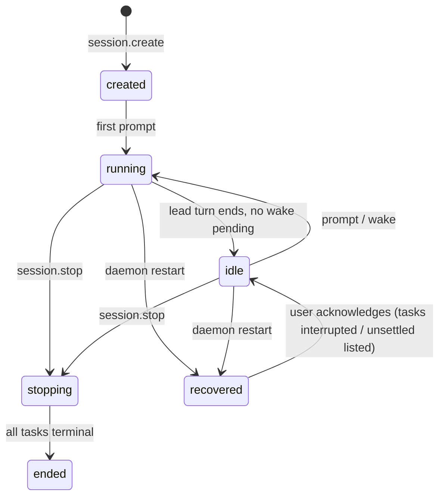
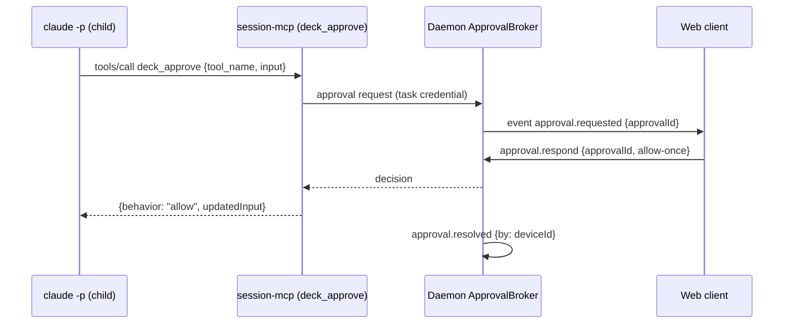

# Design: Cross-Runner Session Core

> Normative behavior is in [spec.md](spec.md); delivery order is in [tasks.md](tasks.md). This document records **decisions, rejected alternatives, and rationale**. Evidence comes from [working-brief.md](working-brief.md) and the current source (verified 2026-10-12 on branch `fix/claude-model-config-blocked-plan`).

## 1. Summary

```
 web/PWA ──(Tailscale Serve, HTTPS)──► 127.0.0.1:<web port> ─┐
 deck cross / deck session (CLI) ───► daemon.sock (0700/0600) ─┤
 TUI (config only) ──► config.json                             ▼
                                         ┌──────────── deck session daemon ───────────┐
                                         │ SessionManager · EventLog · Ledger          │
                                         │ ApprovalBroker · MemoryBroker · Supervisor  │
                                         └──┬──────────────┬──────────────┬────────────┘
                              anchor+pgid   │              │              │
                                     claude -p        codex app-server   opencode serve
                                     (lead?)          (member?)          (member?)
                                         └── each child runs `deck internal session-mcp`
                                             (stdio MCP → daemon.sock, task-scoped credential)
```

One daemon per user hosts many sessions. Each session owns a Lead task and delegated tasks; each task runs in its assigned runner through that adapter's driver. Children reach Deck only through the session MCP bridge.

## 2. Package boundaries

| Unit | Owns | Must not |
|---|---|---|
| `@deck/core` `src/session/` | Event/command types and validators, `RunnerQualifiedAssignment`, `RunnerSessionDriver` interface, redaction rules, child MCP set computation (pure). | Node process/net/fs. |
| **new** `@deck/session-host` (`packages/session-host`) | Daemon core: SessionManager, EventLog, Ledger projection, Supervisor (anchor), ApprovalBroker, MemoryBroker port, HTTP/WS + Unix-socket servers, session MCP bridge server logic. | Import adapters, TUI, CLI argv parsing. |
| `packages/adapter-claude`, `adapter-codex`, `adapter-opencode` | `getSessionDriver()` implementations + recorded fixtures. | Spawn outside the host's supervised spawn; touch credentials. |
| `apps/cli` | Composition: registers drivers, embeds web assets, `deck session`/`deck cross` commands, `deck internal session-daemon|session-mcp|child-anchor`, Doctor, TUI cross flow. | Duplicate host logic. |
| **new** `apps/web` | PWA source (React, already in stack), built by `Bun.build` into a generated, embedded module. | Load third-party origins at runtime. |
| `packages/adapter-pi` | Untouched (uncommitted Pi work is out of bounds). | — |

**D-1 New `@deck/session-host` package.** Rejected: putting the daemon in `@deck/core` (breaks core purity, already repaired once); in `@deck/sdd-runtime` (owns OpenSpec lifecycle, not processes); in `apps/cli` (untestable without CLI composition and tangles with Ink).

## 3. Contracts (S0)

### 3.1 Event envelope — `deck-session-event-v1`

```ts
type SessionEvent = {
  v: 1; sessionId: string; seq: number; ts: string;           // ISO 8601
  kind: SessionEventKind;
  source: { memberId?: string; taskId?: string; runnerId?: RunnerId; nativeSessionId?: string };
  data: Record<string, unknown>;                               // kind-specific, validated
  raw?: { runnerId: RunnerId; protocol: DriverProtocol; payload: unknown; truncated: boolean };
};
```

| Kind group | Kinds |
|---|---|
| Session | `session.created`, `session.bound`, `session.state`, `session.ended`, `session.recovered` |
| Task | `task.created`, `task.state`, `task.continued`, `task.result` |
| Turn | `turn.started`, `turn.completed {status: completed\|interrupted\|interrupted-forced\|failed}` |
| Content | `message.delta`, `message.completed`, `reasoning.delta`, `tool.started`, `tool.completed` |
| Control | `approval.requested`, `approval.resolved`, `memory.recalled`, `memory.proposed`, `memory.written` |
| Ops | `usage`, `rate-limit`, `diagnostic`, `runner.unmapped`, `client.attached`, `client.detached` |

**D-2 Normalize with a raw escape hatch.** Normalized kinds give clients one renderer; `raw` (redacted, ≤64 KiB) preserves detail the mapping drops and makes drift debuggable. Rejected: pass-through native events (three renderers, no cross-runner UI); fully lossless normalization (unbounded schema churn tracking three protocols).

**D-3 Deltas are persisted but compactable.** `message.delta` events are persisted (cursor resume must be gap-free) and, on segment rotation, closed turns may be compacted into their `message.completed`; compaction never renumbers `seq`, and a resume cursor inside a compacted range receives the `message.completed` instead. Rejected: not persisting deltas (mid-turn reconnect would lose text).

### 3.2 Commands — `deck-session-command-v1`

`session.create {projectRoot, changeId?}`, `session.attach {after}`, `session.bindChange {changeId}`, `prompt.send {text, target?: "lead"}`, `turn.interrupt {taskId}`, `approval.respond {approvalId, decision}`, `task.cancel {taskId}`, `session.stop`. All carry `commandId` (UUID) for idempotency (XR-1.5).

### 3.3 Cursor resume

`seq` is the cursor. Attach = "send backlog `seq > after` from the log, then switch to live"; the server holds a per-client bounded queue (default 2 000 events). On overflow it closes with code `resync` and the client reattaches with its last cursor. Rejected: per-client server-side offsets (stateful, breaks with multiple devices); timestamps (not unique).

### 3.4 Runner-qualified assignments

```ts
type RunnerQualifiedAssignment = { runnerId: RunnerId; modelId: string; thinking?: string };
type CrossTeamAssignments = Record<string /* memberId */, RunnerQualifiedAssignment>;
// helpers (pure): qualifyAssignments(runnerId, flat, thinking), projectForRunner(runnerId, cross)
```

**D-4 Add a qualified type next to the flat one; do not mutate the flat type.** Every adapter reads/writes native assignments through `DeveloperTeamModelAssignments` (`readModelAssignments`); changing it would ripple through four adapters and their native files for no user value. Cross assignments live in Deck config only. Rejected: replacing the flat type in place (large blast radius, conflicts with uncommitted Pi work).

**D-5 Config location and migration.** `crossRunner` is an optional key in the existing global `config.json` (single preferences source per [docs/architecture.md](../../../docs/architecture.md)); `DECK_CONFIG_VERSION` stays `1` because the change is additive. Legacy string member values normalize to the qualified shape with a warning (XR-2.2). A task verifies whether pre-change binaries drop unknown keys on write; if they do, the rollback note documents that `crossRunner` must be re-entered after a downgrade. Rejected: separate `cross-runner.json` (violates the one-source invariant); version bump to 2 (forces a migration for unaffected users).

```jsonc
"crossRunner": {
  "enabled": true,
  "members": { "lead": { "runnerId": "claude", "modelId": "opus", "thinking": "high" },
               "apply-deep": { "runnerId": "codex", "modelId": "gpt-5.6-sol", "thinking": "high" } },
  "approvals": { "claude": "relay", "opencode": "relay", "codex": "runner-default" },
  "maxConcurrentTasks": 4,
  "web": { "enabled": false, "port": 7421, "identityAllowlist": [] },
  "claudeTosAcknowledgedAt": null
}
```

Members without an entry are not delegable in cross sessions (the Lead is required).

## 4. Driver interface (RunnerAdapter extension)

```ts
interface RunnerAdapter { /* existing… */ getSessionDriver?(): RunnerSessionDriver }

interface RunnerSessionDriver {
  readonly runnerId: RunnerId;
  readonly protocol: "claude-stream-json" | "codex-app-server" | "opencode-serve";
  readonly testedVersions: { min: string; maxTested: string };
  probe(ctx: DriverProbeContext): Promise<DriverProbe>;            // version, isolation check, capabilities; never reads credentials
  startTask(input: DriverTaskInput, io: DriverHostIo): Promise<DriverTaskHandle>;
}
type DriverTaskInput = {
  taskId: string; memberId: string; cwd: string; assignment: RunnerQualifiedAssignment;
  rolePrompt: string; prompt: string; resume?: { nativeSessionId: string };
  mcp: ChildMcpSet; approvals: "relay" | "runner-default"; credentialFile: string;
  disableNativeDelegation: boolean;
};
type DriverHostIo = { spawn: SupervisedSpawn; emit(e: DriverEvent): void; approval(req): Promise<Decision> };
type DriverTaskHandle = {
  nativeSessionId: Promise<string>; send(prompt: string): Promise<void>;
  interrupt(): Promise<void>; done: Promise<TurnOutcome>; close(): Promise<void>;
};
```

**D-6 Optional method on `RunnerAdapter`, not a parallel registry.** Keeps one composition root (`apps/cli/src/runner-adapters.ts`) and lets a runner without a driver (Pi) be excluded by capability. Rejected: separate driver registry (two sources of runner truth); making it required (forces stubs into Pi).

**D-7 Drivers never spawn.** `SupervisedSpawn` from the host wraps every child in the anchor (section 6). One containment implementation, testable once.

**D-8 One native process per task (per turn for Claude).** The MCP bridge must know *which* task is calling; MCP config (with the task credential file) is per process for all three runners. Rejected: one shared app-server/serve per session (cannot attribute MCP calls to a thread; one crash takes all tasks). Cost: process start latency per task — acceptable for delegation granularity.

### 4.1 Per-runner backend specifics

| Concern | Claude (stream-json) | Codex (app-server JSON-RPC) | OpenCode (serve HTTP+SSE) |
|---|---|---|---|
| Start | `claude -p --model M --session-id <uuid> --input-format stream-json --output-format stream-json --verbose --append-system-prompt <role>` per turn; later turns `--resume <uuid>` | `codex app-server` stdio: `initialize` → `initialized` → `thread/start` or `thread/resume` → `turn/start {model, effort}` | `opencode serve --pure --port 0 --hostname 127.0.0.1`; `POST /session` or reuse id; `POST /session/:id/message {model:{providerID, modelID}}` |
| Native id | Deck-assigned UUID (persisted **before** spawn) | `thread.id` from `thread/start` result | session id from `POST /session` |
| Events | stdout JSONL: `system/init`, `assistant`, `user` (tool results), `result` | notifications: `turn/*`, `item/*`, `thread/tokenUsage/updated`, `account/rateLimits/updated` | SSE `/event`: `session.status`, `message.part.delta`, `session.idle`, `permission.*` |
| MCP isolation | `--strict-mcp-config --mcp-config <0600 file>` (proven) | ignore user config + `-c mcp_servers.<id>.*` (verify auth survives) | Deck-owned config dir via env + `OPENCODE_CONFIG_CONTENT`; **`--pure` alone leaked user MCPs** (spike) |
| Hook isolation | settings override disabling hooks (`--settings` file), never `--bare`; verify `--safe-mode` + explicit MCP compatibility | ignore user config also drops `hooks.json`/config hooks (verify; spike saw duplicate-hook warning) | Deck-owned config dir excludes user plugins |
| Approvals | `--permission-prompt-tool mcp__deck__deck_approve` → `{behavior, updatedInput}` (proven allow path) | server request `item/commandExecution/requestApproval` (+ fileChange) → `{decision}` (accept proven; decline to verify) | `ask` permission → `POST /permission/{id}/reply {reply: once\|always\|reject}` (proven once) |
| Interrupt | `SIGINT` to CLI pid → `result error_during_execution`, exit 0 (proven) | `turn/interrupt {threadId, turnId}` → `turn/completed status interrupted` (proven) | `POST /session/{id}/abort` → idle (proven) |
| Native delegation off | `--disallowedTools Task` (verify name) | disable multi-agent feature via `-c` (verify) | permission `task: deny` |
| Pitfalls | Without relay/allowedTools headless denies (`permission_denials`) | stdin must be a pipe we own (exec blocked on stdin when inherited); experimental protocol | Long-lived server per task; random port; set server password if supported (verify) |

**D-9 OpenCode isolation via a Deck-owned config directory.** The spike shows `--pure` + config content still loaded user MCPs, so Deck points OpenCode's config home at a per-task Deck-owned directory while leaving its data home (where auth lives) untouched, and verifies isolation via the probe's tool list. Rejected: deny-listing every user MCP id (fragile, races user edits); copying auth (violates the credential non-goal).

## 5. Delegation and the proxied Lead (S3)

**D-10 Delegation as a Deck MCP server, async with daemon wake.** All three runners already accept a Deck stdio MCP server (spike round 2), and Deck already ships `deck internal memory-mcp`/`serena-mcp` the same way. `deck_delegate` returns a `taskId` immediately because runner MCP tool-call timeouts (e.g. Codex default tool timeout) make long-blocking calls unsafe; `deck_task_wait` is bounded to ≤50 s; when the Lead goes idle with pending tasks, the daemon wakes it with a completion notice (the Pi `notify` pattern). Rejected: blocking `deck_delegate` until completion (timeouts, no concurrency); runner-native subagents (cannot cross runners); Pi as host (user decision).

**D-11 Bridge transport.** `deck internal session-mcp` speaks MCP stdio to the child and JSON frames to `daemon.sock`, authenticated by a task-scoped credential read from a `0600` file named in env (`DECK_SESSION_CREDENTIAL_FILE`). The credential encodes `{sessionId, taskId, memberId, allowedTools}` server-side and is revoked when the task ends. Rejected: token in argv/inline MCP JSON (visible in `ps`); TCP loopback for children (would share the web port).

```mermaid
sequenceDiagram
  participant U as Client (web/CLI)
  participant D as Daemon
  participant L as Lead (claude -p)
  participant B as session-mcp bridge (in Lead)
  participant C as Codex app-server (architect)
  U->>D: prompt.send(commandId)
  D->>L: spawn turn (--resume lead uuid)
  L->>B: tools/call deck_delegate {agent: architect, task}
  B->>D: delegate (task credential)
  D->>D: ledger task.created T1 {codex, model, thinking}
  D-->>B: {taskId: T1}
  B-->>L: {taskId: T1}
  D->>C: spawn anchor → app-server; thread/start; turn/start
  C-->>D: item/* notifications → normalized events (seq++)
  L-->>D: result (turn completed, Lead idle)
  C-->>D: turn/completed
  D->>D: task.state T1 completed, nativeSessionId = thread N
  D->>L: wake turn: "T1 completed" (bounded notice)
  L->>B: deck_task_result {T1}
  Note over L,C: Later: deck_delegate {architect, continueTaskId: T1} → thread/resume N
```

**D-12 Owner contract.** The ledger maps `taskId → [{attempt, runnerId, modelId, thinking, nativeSessionId, state}]`. Continuation uses the **recorded** runner/model because native context is not portable; assignment changes affect new tasks only. If native resume fails (expired/missing), reseed a fresh native session with a bounded Deck summary from the event log and mark `continuity: reseeded`. Rejected: following the current assignment on continuation (silently loses context); refusing on resume failure (dead end for the user).

**D-13 Only the Lead delegates.** Matches the existing team model (Lead coordinates; specialists do not re-delegate) and bounds fan-out. Depth > 1 is a later decision.

## 6. Supervision, persistence, lifecycle

### 6.1 Process containment (ported lessons from the Pi supervisor/lease)

`deck internal child-anchor` is spawned `detached` (own process group) with an IPC channel. It spawns the native CLI inside its group and:
- on IPC `disconnect` (daemon died) → `kill(-pgid, SIGKILL)`;
- reports `exit` only after stdout/stderr reach EOF or a 1 s drain timeout (never promote partial output to success);
- never exits before the daemon acknowledges terminal cleanup (prevents PID reuse races).

Recovery **never signals a PID read from disk**. On Linux it verifies `(pid, starttime, boot_id)`; on Darwin it accepts only proven absence (`kill(pid, 0)` → `ESRCH`) within the same `kern.bootsessionuuid`; anything else is `ownership-unsettled` (XR-3.7). Interrupt sends `SIGINT` to the CLI pid only (Claude needs a clean `result`), escalation targets the group.

**D-14 Children die with the daemon; continuity comes from native resume.** Stdio-piped children cannot be re-adopted by a new daemon. Rejected: surviving children with re-attach (requires named pipes/PTYs per runner, high complexity, orphan risk).

### 6.2 Storage layout (user state dir, never the repo)

```
$XDG_STATE_HOME/deck/                    (default ~/.local/state/deck)
  daemon/  daemon.lock  daemon.sock*  daemon.json (pid, nonce, version, ports)
  sessions/<sessionId>/
    session.json        project root, changeId, state, created, members snapshot
    events/000001.jsonl append-only, rotate at 16 MiB
    ledger.snapshot.json  projection checkpoint {seq, tasks}
    tasks/<taskId>/     credential (0600, deleted at terminal), mcp-config files, scratch
  web/ devices.json (hashed tokens), pairing (ephemeral)
  logs/daemon-YYYYMMDD.jsonl (rotated, redacted)
```
\* If the socket path exceeds the platform `sun_path` limit (104 bytes on Darwin), use `$TMPDIR/deck-<uid>/daemon.sock` after verifying owner and `0700`.

Writes: append + `fsync` per batch (≤50 ms window); snapshot via atomic rename. Retention default: 30 days or 50 sessions, whichever is smaller; `deck session prune`.

**D-15 Event sourcing for the ledger.** One durable truth (the log); the snapshot is an optimization rebuilt on mismatch. Rejected: SQLite (native module across 4 compiled targets — `bun:sqlite` is viable but adds a schema/migration surface for no current query need); writing ledger into OpenSpec (OpenSpec is authoritative change history, not runtime state; it must stay user/agent-governed).

### 6.3 Lifecycle



- **Start:** client checks `daemon.json` + socket ping; else spawns `deck internal session-daemon` detached, waits for readiness (≤5 s), single instance via lock (pid + nonce, same pattern as config lock).
- **Attach / reattach:** `session.attach {after}`; disconnect never affects tasks.
- **Idle shutdown:** no live session (all `idle`/`ended`), no clients, 30 min → graceful exit. Running tasks keep it alive.
- **Crash recovery:** see 6.1; sessions become `recovered`, tasks `interrupted`/`ownership-unsettled`; the user (or Lead on next prompt) may continue tasks via owner contract.
- **Version skew:** client and daemon exchange build versions; a newer client asks an idle older daemon to restart; never restart with running tasks.

## 7. Approvals and interrupt



- Timeout (default 15 min) → `deny`, `by: timeout`. Child env sets the runner's MCP tool timeout above the approval timeout where configurable (Claude `MCP_TOOL_TIMEOUT`; verify).
- **D-16 Approval defaults:** Claude `relay` (headless otherwise denies everything), OpenCode `relay`, Codex `runner-default` because the always-on bypass is an approved requirement; Codex relay is implemented and contract-tested but opt-in (open question 2). Rejected: forcing relay everywhere (contradicts an approved requirement); `allowedTools` lists for Claude (silent power without visibility).
- Interrupt per runner as in section 4.1; 10 s escalation to group TERM/KILL (`interrupted-forced`).

## 8. Shared services

- **OpenSpec:** session binds to ≤1 change (XR-7.1). The Lead and specialists keep the existing Developer Team registry rules; the daemon only injects the change path into role prompts and records `session.bound`. **D-17** Session binding is optional at creation so direct-delta work still fits; once bound it is immutable.
- **Adaptive memory (D-18):** the MemoryBroker composes the existing `SupermemoryRuntimeHost` (`apps/cli/src/supermemory-runtime-host.ts`) through a port injected by `apps/cli`. Children get `deck_memory_recall` and `deck_memory_propose`; the broker deduplicates per session and is the single writer. Native memory MCPs/plugins are excluded by XR-4.4. Rejected: each child writing via its runner's memory integration (duplicates, cross-runner identity drift, credentials in children).
- **Web search:** Tavily is stateless; each child gets the configured web-search MCP in its explicit set with the credential resolved by the existing owned-credential path (env overlay, never argv).

## 9. Web client and security model (S4)

Threat model: single user; attackers are (a) other tailnet devices/users, (b) the public internet, (c) malicious web pages in the user's browser, (d) untrusted model output rendered in the client. Local processes of the same OS user are trusted (they already hold the user's authority).

| Control | Decision |
|---|---|
| Reachability | Web listener off by default; `127.0.0.1` only; user runs `tailscale serve` (Deck prints the exact command; never runs `funnel`). |
| Authentication | One-time pairing code from `deck session pair` (6–8 words or 128-bit code, single use, ≤5 min, 5 attempts) → device credential (256-bit) in HttpOnly/Secure/SameSite=Strict cookie; stored as SHA-256 hash; `deck session devices revoke`. |
| Identity | If `Tailscale-User-Login` present → must be in allowlist (default: the login that paired). Reject requests carrying Tailscale's Funnel marker header (verify header name). |
| CSRF/Origin | Exact Origin match for POST and WS upgrade; JSON-only commands. |
| Content | Strict CSP (`default-src 'self'`), all assets embedded, model output rendered as text/sanitized Markdown, no inline HTML from children. |
| Surface | Only sessions/events/commands/approvals; no bridge, no admin, no file browsing. |

**D-19 Two listeners.** Unix socket for full local authority; loopback TCP for the restricted web API. Rejected: one TCP port for everything (Tailscale Serve would expose the bridge surface); HTTPS in-daemon (Tailscale Serve terminates TLS with a valid `ts.net` cert).

**D-20 Embedded assets.** `apps/web` is bundled by `Bun.build` and emitted to `apps/cli/src/runtime/web-assets.generated.ts` (path → base64 + content-type + digest manifest) by a generator wired into `prepareStandaloneBinaryBuild`, mirroring existing generated modules. JSON Schemas for events/commands are generated into the same pattern. Rejected: `with { type: "file" }` imports (works in Bun compile but no digest manifest; less uniform with existing generators); reading assets from disk (violates "no repo paths").

## 10. TUI changes (S5)

- Start installation lists **cross** after concrete runners. It is a TUI flow, **not** a registered `RunnerAdapter` (**D-21**; a fake adapter would have to stub install/verify/rollback and blur the "adapter = runner-native translation" boundary).
- Flow: members list (`lead … setup`, each showing `runner · model · thinking` or "unassigned") → member → **runner list** (installed runners with `getSessionDriver`) → that runner's models (reuse its inventory/discovery screens) → thinking levels (`adapter.getThinkingLevels`/`resolveThinking`) → review (shows runners that still need installation, ToS acknowledgement for Claude) → save `crossRunner`.
- Replace the global `modelConfigRuntime` dependency in the picker with an explicit target: `{kind: "runner-native", runnerId} | {kind: "cross-member", memberId, runnerId}`. Existing runner-native paths keep current behavior; only the save step branches.

## 11. Drift control and version pinning

- Initial tested versions: Claude `2.1.296`, Codex `0.162.1` (driver min `0.162.1`, separate from adapter `MINIMUM_CODEX_VERSION = 0.145.0`), OpenCode `1.18.31`.
- **Recorded fixtures:** sanitized JSONL/SSE transcripts per runner/version under each adapter's `src/session-driver/__fixtures__/<version>/`, produced from the spike scripts. Driver parsers and mappers are unit-tested against them in `bun test` (no network, per [config.yaml](../../config.yaml) security constraints).
- **Live contract script:** `bun run scripts/session-contract-live.ts <runner>` (opt-in, not a CI gate) runs the spike flows against the installed CLI and diffs event **shapes** (types/keys) against fixtures; failures produce a new fixture proposal.
- Out-of-range versions: below min → `blocked`; above max → `degraded` warning with continued operation and `runner.unmapped` capture.

**Codex 0.162.1 compatibility (S0 task).** The local install moved to `vendor/aarch64-apple-darwin/bin/codex` after the revoked 0.130.0 binary. Verify the adapter's executable detection, version parse, model discovery, `--dangerously-bypass-hook-trust`, and hook-duplication warning against 0.162.1, independently of the daemon.

## 12. Observability

- Daemon JSONL log: lifecycle, driver probes, spawn/exit (pid, pgid, signal, drain result), approvals (no input bodies), errors; redaction with the Pi `clean()` rules ported into core.
- Per-session `usage` and `rate-limit` events; turn durations in `turn.completed`.
- `deck session status [--json]`; Doctor checks: daemon reachable, driver versions/isolation, web listener, Funnel state, stale `ownership-unsettled` tasks, disk usage of sessions.

## 13. Failure modes

| Failure | Behavior |
|---|---|
| Native CLI missing/unauthenticated | Probe → `blocked` with reason; session create refuses that member; no credential inspection beyond the CLI's own status command. |
| Child crashes mid-turn | `turn.completed failed`, task `failed` with exit code/signal; Lead woken with notice; continuation available. |
| Daemon crash | Anchors kill groups; restart → `recovered` (6.1). |
| Disk full / log write failure | Session enters `stopping`; no further prompts accepted; clients get `diagnostic`. |
| Approval timeout | `deny` + event; task continues per runner semantics. |
| Interrupt ignored | 10 s → group TERM → grace → KILL, `interrupted-forced`. |
| Protocol drift | `runner.unmapped` + `degraded` probe; terminal-state detection failure → task timeout (default 60 min, configurable). |
| MCP bridge cannot reach daemon | Bridge returns MCP error; daemon is the authority, child continues without Deck tools; diagnostic logged. |
| Rate limits | Surfaced as `rate-limit` events; no automatic model fallback. |
| Two clients answer one approval | First valid response wins; second gets `already-resolved`. |

## 14. Personal-use and ToS posture

Deck spawns the **unmodified** native CLIs as the signed-in OS user, on the user's machine, for that user's own work. Deck never touches credential files, never proxies auth, never uses `--bare` or API-key substitution for Claude, and offers no multi-user features. Residual risk: Anthropic has not confirmed whether an orchestrator spawning `claude -p` under a consumer subscription is "ordinary individual use". The Claude driver therefore requires an explicit, recorded acknowledgement (XR-12.1) and is independently disable-able; documentation states the ambiguity plainly.

## 15. Stage plan

| Stage | Ships | Independently verifiable by |
|---|---|---|
| **S0** Contracts + config | Core session types/validators, qualified assignments, `crossRunner` config + migration, redaction, Codex 0.162.1 audit. | Unit tests; no runtime behavior change. |
| **S1** Daemon core + Claude driver + CLI client | `@deck/session-host`, anchor, event log/ledger, socket server, `deck internal session-daemon/session-mcp/child-anchor`, Claude driver (single-member Lead session), approvals relay, interrupt, `deck cross developer` terminal client. | Fixture tests, fake-child integration tests, host binary smoke, manual live run. |
| **S2** Codex + OpenCode drivers | Two drivers with isolation, approvals, interrupt, fixtures, probes. | Fixture + fake-server tests; live contract script. |
| **S3** Proxied Lead + delegation + shared services | Delegation tools, wake, owner-contract continuation, reseed, MemoryBroker, web search in child set, change binding. | Integration tests with fake drivers; live 3-runner run. |
| **S4** Web/PWA + Tailscale | Web listener, pairing, devices, embedded assets, PWA. | HTTP security tests, Playwright against host binary. |
| **S5** TUI cross + docs | TUI flow, Doctor, docs/support matrix. | Render-only TUI tests; doc review. |

**D-22 S1 driver = Claude.** Lowest integration risk on the evidence: the caller assigns the native session id (`--session-id`), so the ledger entry exists before spawn; per-turn processes leave no long-lived server state to recover; strict MCP isolation, approval relay through a Deck MCP tool, and clean `SIGINT` are all proven; and the relay path builds the session MCP bridge S3 needs anyway. Rejected: **Codex** first (experimental app-server protocol, fragile install history on this machine); **OpenCode** first (isolation leak unresolved, one long-lived server per task). The ToS posture is identical whichever stage introduces Claude, and S1 gates it behind acknowledgement.

## Open questions

Ranked; each has a default that tasks assume until the user answers.

1. **Claude ToS residual risk.** Do you accept the documented ambiguity for personal use behind a one-time acknowledgement? *Default:* yes, gated (XR-12.1); if no, swap S1 to OpenCode and ship Claude last.
2. **Codex approvals in cross sessions.** Keep the approved always-on bypass, or relay approvals with sandbox on (useful when approving from the phone)? *Default:* keep bypass; relay opt-in per config.
3. **Daemon availability for remote start.** Should the phone be able to start sessions when no terminal is open (requires a launchd/systemd user service)? *Default:* no OS service; the daemon starts from a terminal command and stays up while sessions are live (`deck session daemon --keep-alive` available).

Resolved by default (no user input needed): only the Lead delegates; continuation uses recorded runner; session binding optional but immutable; max 4 concurrent tasks; approval timeout 15 min; idle shutdown 30 min; retention 30 days/50 sessions; Pi excluded from drivers in this change.
