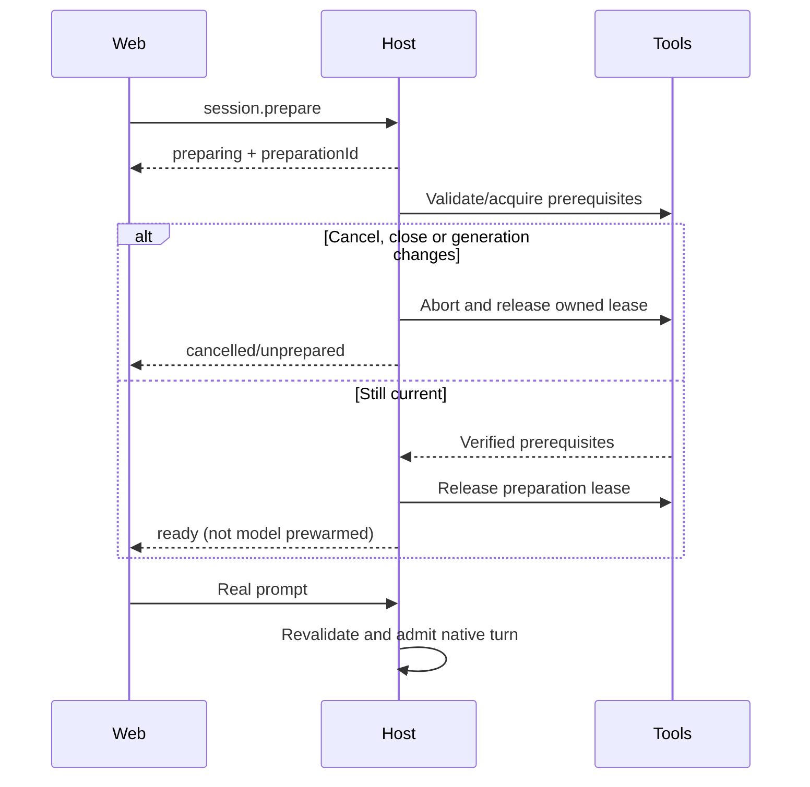
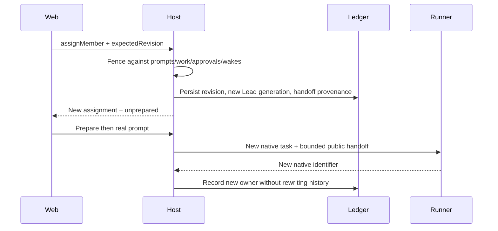

# Workspace implementation contract

Status: user-authorized implementation contract, 2026-10-15. Requirements are XR-13.1–13.9; historical behavior is recorded in workspace-evolution-brief.md. Lead owns this artifact.

## Ownership and compatibility

Core owns validation and shared contracts. Session host owns persistent projects, queries/commands, preparation, Lead generations and admission. CLI composes real adapter model discovery and the global web command. Web consumes these boundaries and preserves the accepted responsive layout and scroll behavior.

Existing commands, histories and native task owners remain compatible. Legacy session roots are imported idempotently. The directory autocomplete boundary does not erase or rewrite existing CLI-created history outside the user's home. No project selection or preparation sends a model prompt.

## Public surface

Use the existing authenticated command envelope and `CommandOutcome` responses.

| Command | Additional fields | Successful data |
|---|---|---|
| `project.register` | `path`, optional `name` | `{project}` |
| `session.create` | `projectId`, optional `title`, `members`, `changeId`; preserve legacy `projectRoot` alternative | `{sessionId}` |
| `session.prepare` | None; envelope selects session | `{preparation}` immediately |
| `session.prepare.cancel` | `preparationId` | Updated preparation |
| `session.release` | None; envelope selects session | `{preparation}` with `releasing` until drain completes |
| `session.rename` | `title`, trimmed nonempty, maximum 160 characters | `{title}` |
| `session.remove` | None; envelope selects session | `{state: "removing", preparation}` until drain and durable hide |
| `session.continue` | Optional `title`; envelope selects ended source | `{sessionId}` of successor |
| `session.assignMember` | `memberId`, `assignment`, `expectedRevision` | `{revision,generation,continuity}` |
| `session.stop` | Existing contract | Existing outcome |

Reject contradictory root/project identifiers, invalid assignments and stale revisions. Create member overrides atomically. Commands remain idempotent across retries; continuing a closed session must recover the same successor for the same command identifier after a crash.

| Route | Query | Data |
|---|---|---|
| `GET /api/projects` | `projects.list` | `{projects:[{projectId,path,name,createdAt,available}]}` |
| `GET /api/directories?path=&prefix=&limit=` | `directories.list` | `{root,path,directories:[{name,path}],truncated}` |
| `GET /api/sessions?projectId=&cursor=&limit=` | `sessions.list` | `{sessions,nextCursor?}`; legacy unfiltered CLI behavior retained |
| `GET /api/sessions/:id/readiness` | `session.readiness` | Prepared session state |
| `GET /api/models?projectId=` | `runners.models` | `{runners:[{runnerId,label,available,reasonCode?,models:[{modelId,label,thinkingLevels}]}]}` |

Session summaries add `projectId`, `title`, `predecessorSessionId`, `generation`, `assignmentRevision`, `members`, and `currentLeadTaskId`. The host's optional `modelCatalog(projectRoot)` callback is supplied by CLI composition using real adapter catalogs and model-specific thinking levels. Missing discovery is reported, never replaced with invented models.

## D-32 Global workspace entry

`deck web` ensures the existing daemon/listener is available and opens or reports its local URL. It does not implicitly create a project or session and does not depend on the shell directory. Existing cross launch remains a project shortcut. Shell entry, daemon lifetime and session lifetime remain separate concepts.

## D-33 Project identity and directory completion

Persist stable project identifiers derived from the canonical absolute root (a bounded SHA-256 digest) under private user state. Deterministic identity allows legacy import and summary lookup without rewriting historical metadata; identifiers are not authentication tokens. A single owning daemon serializes writes; canonical directory identity deduplicates aliases. Import existing roots without changing native or memory identity. Missing directories stay visible as unavailable.

Completion lists bounded direct-child directories inside canonical user home. Revalidate containment after canonicalization, reject traversal/symlink escapes, preserve authentication and exact Host/Origin checks, and never read file contents, recursively crawl or execute repository code. Listing a path is not project registration or session admission.

## D-34 Preparation and finalization

Readiness states are `unprepared`, `preparing`, `ready`, `releasing`, `failed`, and `cancelled`, with generation, optional preparation identifier, phase, reason code and checked timestamp. Emit `diagnostic` with `code: "session.preparation"` and bounded readiness fields. Concurrent same-generation preparation coalesces.

Preparation validates current directory, runner compatibility, configuration, instructions, memory and MCP prerequisites without starting an inference task. Cancel/timeout/stop/assignment-change/shutdown abort and release owned resources exactly once. Generation and preparation identity fence stale completion. Restart resets readiness. Actual turns still revalidate current prerequisites. The browser retains drafts and gates submission; the direct CLI path remains compatible.

Correction authorized 2026-10-15: Web Close uses `session.release`, drains selected owned resources and returns the same session to unprepared readiness. Persist release intent before cancellation; block prompts, wakes, delegation and recovery execution until explicit preparation. Preserve ID, history, attachments, compatible native identifiers and paused pending messages. Prepare may explicitly reopen a safely settled legacy ended session in place. Stale lifecycle retries and preparation callbacks cannot affect a newer prepared epoch. Browser closure remains detachment. See `session-release-brief.md`.

The explicit legacy `session.stop` API remains terminal. Explicit `session.continue` remains an optional linked-successor operation using effective assignments and the same project/change binding, with bounded public conversation context (last eight messages, at most 8,192 characters) and source provenance. It is no longer the ordinary web reconnection path. Do not create fictitious user messages or transfer tool payloads/credentials.

Session Rename persists a bounded display title. Remove persists an admission fence, drains selected resources, then hides the catalog row; unresolved ownership keeps a visible removing state. No files or saved history are purged, and authenticated known-ID history/attachment reads retain existing authorization. Reject mutations after removal. Readiness-backed green/gray connection dots remain separate from activity/unread indicators; ready does not imply native inference is running.

## D-35 Assignment revisions and Lead generations

Session overrides are explicit and durable. New delegates resolve session override, then current global configuration, then creation snapshot. Continued delegated tasks always keep their recorded owners. Lead resolves session override, then creation snapshot.

Changing the Lead requires idle state, no pending approvals or undelivered completions, and serialized admission. Each actual change records a revision and new task ID `lead-gN`; `memberId: "lead"` remains the authoritative role. Historical tasks/attempts/native IDs are never overwritten. No-op selection need not create a generation.

The initial implementation starts fresh native context for every real Lead assignment change, including same-runner model changes. This avoids assuming unverified native model-switch support. Preserve the Deck timeline and provide explicit bounded handoff with `continuity: "reseeded"`. Returning to a previous runner does not revive an old native ID. Old delegated continuations remain on their owners; their completion must reach the current Lead exactly once.

All consumers must recognize Lead by role/current generation: authorization, delegation, wake delivery, interruption, Chat, Activity, progress, receipts and Subagents exclusion. UI messages retain actual historical runner/model provenance.

## D-36 Fair global native task admission

`crossRunner.executionBudget` defaults to `{lead: 2, delegated: 4}` with positive bounded capacities. Separate pools avoid blocked Leads occupying all child capacity. Existing per-session delegate limits remain in force.

Each pool uses round-robin among eligible sessions and FIFO within a session. Completion wakeups consume Lead capacity. Cancellation removes only its ticket; lease release follows native drain/cleanup, not merely a reported model completion. Unproven ownership must not free a slot for a replacement process. Report queue reasons `global-lead-capacity` and `global-delegated-capacity` explicitly.

The default bounds active native task handles to six. It does not bound every shared MCP/helper process. Dynamically lower limits do not kill active tasks; admission waits for safe capacity. Preparation itself does not consume a native inference slot.

## Acceptance and delivery

Verify path/auth boundaries, legacy migration, two independent sessions in a shared directory, cancellation/late preparation results, idempotent linked continuation, idle/busy revision races, generation replay and native-ID isolation, current-Lead completion delivery, catalog provenance, global fairness/deadlock avoidance, and actual backend/browser interaction. Preserve themes, Markdown, scrolling, accessibility and drafts.

Run focused checks during implementation, then one frozen integrated gate with generated schemas/assets, TypeScript, applicable repository tests, all four compiled targets and supported host/Linux runtime checks. Independently review protected boundaries before local canary activation. No automatic worktrees, OS services or unverified native prewarming are part of this contract.
