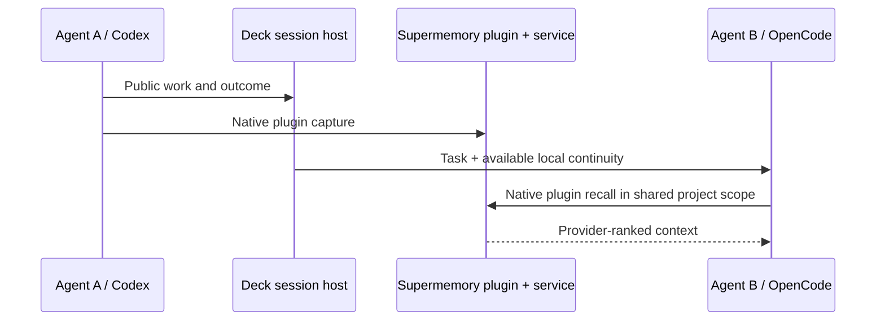

# Design: native plugins own remote memory

Status: Lead-adopted architecture direction; compatibility and implementation verification pending. This design supersedes the older instrumentation-first sequence, not historical evidence.

## ADR-1: Preserve provider-native capture and recall

Use the official supported Supermemory plugins inside native runners and cross-runner members. Candidate upgrades are Codex1.1.0 and OpenCode2.1.0; inspect immutable artifacts and integrate their actual dependency/configuration contracts. Claude requires an immutable reviewed v5-capable revision. No official Pi plugin was established by the bounded research; resolve that gap explicitly rather than claiming parity.

Supermemory owns extraction, semantic organization, ranking and native remote injection. Deck owns composition, project identity, lifecycle and context delivery. Do not run a second automatic remote writer/search pipeline for plugin-owned event ranges. Do not overlay semantic importance filters, topic allowlists or role/runner eligibility exclusions. Preserve supported full-conversation capture settings and native tools.

Rationale: updating only the legacy REST adapter misses managed native integrations and repeats functionality already provided by the plugins. Plugin restrictions and genuine provider limits must be described accurately; Deck must not claim complete capture when a native parser omits content.

## ADR-2: Cross-runner continuity comes first

Use the same verified project memory binding across Codex and OpenCode. Runner and role are provenance, not barriers to applicable memory. Verify metadata filters as well as namespace equality. Host-origin delegated tasks must reach actual native recall hooks/context injection; short tasks must reach supported capture callbacks. Preserve native role/skill loading, immutable readiness provenance and unrelated user customization.

The diagram is the target, not a claim of present runtime behavior. Local delivery must not wait for remote extraction. Reuse existing durable session events first; add only missing delivery/persistence seams, without another semantic memory engine. Distinguish local availability, hook completion, remote acceptance and remote processing. Preserve cancelled/failed outcomes as such.

## ADR-3: Complement only demonstrated gaps

Implement and exercise updated native plugins before choosing a receipt proxy, queue or new journal. If supported hooks/state provide sufficient completion evidence, use them. If not, document the concrete gap and add the smallest complementary seam. A transparent v5 receipt bridge is an option, not an adopted prerequisite. It must never fabricate successful provider acceptance or blindly retry uncertain append writes.

Pending local context and remote recall remain distinguishable. Context delivery must respect actual runner limits with visible continuation where necessary; no silent relevance filtering or new universal token quota. Capture missing public observations only through a nonoverlapping complementary path justified by a verified plugin gap. Credentials and private reasoning are not memory input.

## Boundaries and compatibility

Keep session-host provider-neutral; CLI composition supplies adapters. Preserve verified capture identity, credential exclusion, user-selected enablement and OpenSpec authority. Explicit account-accessible tool scope is authorized in ADR-4 below; do not misrepresent it as project isolation. Scope-absent global behavior must be explicitly compatible with v5 or retain a supported legacy mode; do not redirect it to an invented project namespace. Disabled memory makes no provider calls. Provider outage must not be mislabeled as successful capture.

Real v5 changes include namespace paths, add IDs and append semantics, typed search filters/rerank, independent profile/search, provenance and separate indexing/memory-generation states. Prefer the plugin's implementation; do not mechanically rewrite legacy URL prefixes. Source facts: the public v5 OpenAPI snapshot and exact plugin artifacts recorded in the private architecture evidence.

## ADR-4: Account-accessible tools with project organization and project-first use

The user explicitly authorized the official Codex hosted tools' account-accessible scope on2026-10-31, while requiring memories to remain organized by project and consultation to prioritize the current project. Decision decision-d9c184d6f5fe4d64be8b2f175a15f819, admitted user prompt edcb5ff4-575a-4c40-91ee-f0a5c4a0c5a9. This supersedes strict project-only access for that hosted tool channel, not the identity used for automatic capture.

Separate storage attribution, accessible namespaces and retrieval preference. Automatic capture retains the canonical project binding shared by native/cross-runner launches. Supply the current project identity to native tool use, and use supported explicit namespace parameters for project-specific writes and searches. Preserve access to other credential-authorized spaces when useful; do not build a semantic result filter, change provider ranking or restrict the complete native tool surface to enforce preference. Intentionally shared knowledge can remain in its appropriate shared space without silently relocating project records.

Project-first means starting project-specific consultation in the current project's namespace and allowing broader consultation when needed or requested. It is not a guarantee that an unscoped hosted query ranks that project first. Current upstream defaults use account active/default space; do not mutate shared account active-space state at runner launch to simulate a task-local default. Verify supported per-call selectors and actual agent context/tool behavior, disclose guidance-only behavior where applicable, and do not claim deterministic routing from instructions alone. Any operation without a project selector retains its documented native account behavior.

Acceptance must exercise two different projects, shared knowledge, explicit project writes/queries and broader retrieval under native and managed launches. Verify provenance and account permissions independently of result ranking. No account migration, personal installation or paid run follows from this scope decision.

## Sequence

1. Updated Codex/OpenCode plugins in actual managed and native launch composition, common project scope and faithful plugin capture/recall. Verify against fake provider effects and isolated homes; expose concrete remaining lifecycle gaps.
2. Complete immediate local handoff/resume delivery and any demonstrated short-task capture gap. Prove both local pending context and later remote recall without duplicate ingestion.
3. Extend verified behavior to Claude/native paths and explicitly supported missing-plugin paths; remove remaining legacy Deck semantic restrictions and provide source/operation access where missing.
4. Non-destructive migration and matched outcome comparison. Do not revive the old pilot or large proposed protocol automatically.

## Pi complementary adapter follow-through

The inspected Pi composition has no admitted official Supermemory plugin. Retain its existing Deck extension as the complementary native adapter, using the verified v5 project namespace and write/append contracts. Remove semantic capture eligibility and role-based automatic-memory exclusions. Admit only authenticated public inputs/outputs, retain provenance, and separate automatic observation capture from permissions for explicit mutations. Preserve provider order and supported query options; make real transport/context limits visible with recoverable remainder. Do not introduce a second writer for Codex/OpenCode/Claude or expand Pi beyond its supported native roles and Setup-only cross driver. Scope-absent legacy compatibility and disabled behavior remain explicit. This follows the reviewed closure reconciliation; it does not assert an exhaustive absence of official Pi integrations.

## Native root-role continuity exposed by memory verification

The tested Codex release drops prior invocation-only developer instructions on cold resume/context rebuild even without memory composition. Refresh Deck’s known root bootstrap through the existing authenticated SessionStart context for positively identified Deck root launches, bound to the current launch/generation and independent of memory enablement. Preserve native durable user role configuration and managed child role selection. Do not infer a root role from arbitrary transcript contents or replace unrelated resumed-session instructions. Verify the actual Deck bootstrap, not only a durable test sentinel, after cold resume and compaction; both evaluation arms require identical role behavior.
