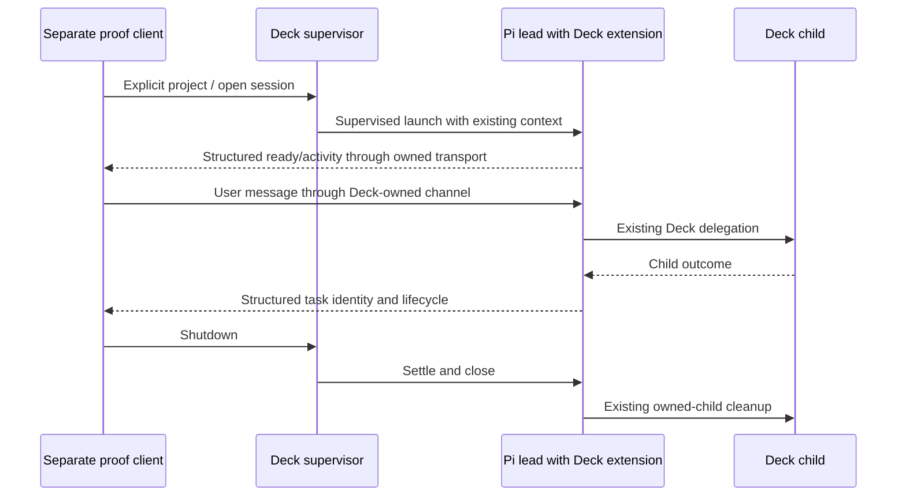

# Minimal integration design

## Decision
Use an opt-in Deck-owned structured headless path consumed by a separate proof client. Prefer subprocess/stdin/stdout over adding a browser server for this slice. Final protocol framing and exported surface must follow existing contracts rather than guesses.

## Sequence

## Invariants
- Deck owns composition and cleanup; the client does not reconstruct configuration, copy credentials, or create an independent scheduler.
- The Pi adapter currently rejects non-interactive launch. Supporting a headless option requires actual contract/spawn integration, not simply removing that guard.
- Standard output framing must not mix banners, diagnostics, prompts, or tool logs into machine records.
- Drain output, bound buffering, validate command records, and preserve cancellation/failure semantics.
- Subagent reporting must use existing BackgroundJobs/task identities; the TUI overlay is not a web interface.
- No terminal takeover, two simultaneous writers, durable daemon, full browser reconnect, or saved-project implementation is required here.
- No app authentication. An owned stdio channel avoids a browser network endpoint. If a network endpoint proves necessary, document and test the no-login local threat model before exposing it.
- Do not silently bypass installation confirmations, policy enforcement, or unsupported extension interactions.

## Validation design
Use isolated temporary homes/projects, deterministic fake providers rather than network, and existing native extension test patterns. Exercise actual Pi/Deck wiring where available and explicitly report any blocked native proof. Do not mutate runner profiles or run canary installation.

## Open questions for implementation
Which minimal generic launch entry best preserves the current runtime? How are extension job snapshots/events made observable? Which confirmation interactions are supported headlessly? How does parent shutdown settle all owned children? Resolve narrowly with tests and return decisions to Lead for this record.
